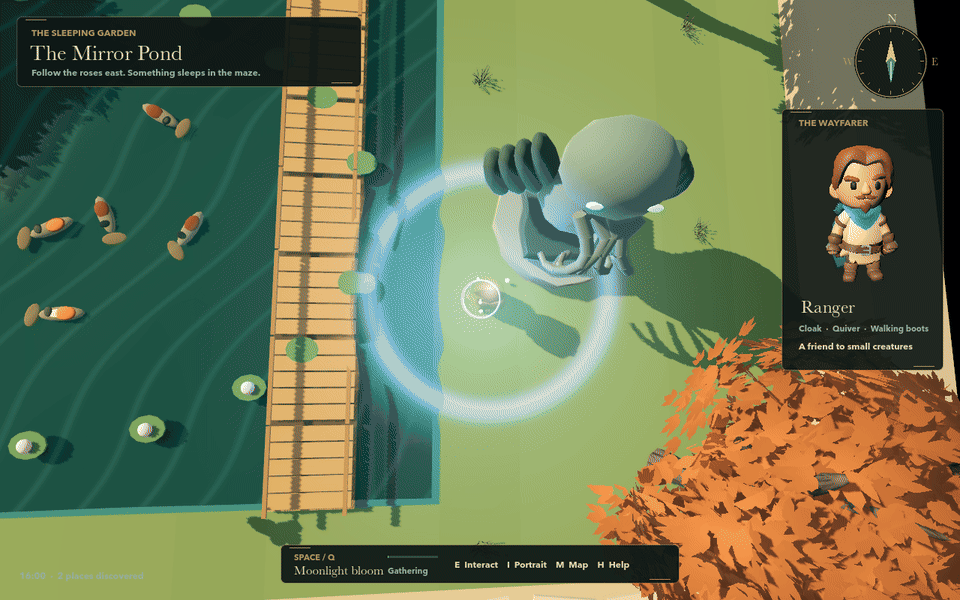

# The Sleeping Garden — validation, 2026-09-08

Default scene: `demos/living_garden/garden.tscn`.

- 36×30 ground area, 1148 total cells including the retained raised terraces.
- Continuous woodland slopes with two rests and a1.3m ridge, plus the original
  three stair flights/cellar/door/ember/day-night systems.
- 34trees:8birches,11maples,5pines,9sage broadleaf trees and1deadwood form.
  Largest pine measures10.383m. Five placements reuse the trained8k cloud;
  Ranger uses the trained3k walk, for43k fitted Gaussians across the full world.
- `rose_wall` TileDef, climbing vine/rose dressing, a seeded13×13 hedge maze,
  a reachable shrine court and two original tentacled stone figures.
- Six rabbits, four birds and six koi. Bounded local motion; rabbits respect
  walkability and terrain height. This is ambient wildlife, not a combat AI system.
- Animated water normals/highlights, transparency and a ReflectionProbe capture.
  Reflections represent a captured environment, not continuously updated planar
  mirrors of moving fish/characters. The normal animation continues at runtime.
- Space:Verdant pulse (swirl). Q:Moonlight bloom (radial breathing). Both combine
  GPU particles, a light/ring, screen-space refraction and a spatial DistortionField.
- Compass, live3D Ranger paper-doll view, discovered-area labels, M map,
  H/F1/Escape help. I toggles the portrait. Help/map suppress player movement.
  Space is removed from ui_accept so casting cannot also open a nearby door.

## Checks

`tests/test_living_garden.gd`:PASS,0failures. Walks up/down the ridge and all40
steps of the maze's BFS solution through actual collision/walkability; verifies
shrine activation/collision, spell recharge/different warp modes, fitted-tree
count/landmark height, wildlife motion, help/map controls, movement suppression
and room-scoped outdoor visibility. Eight real GPU checkpoints are included.
`tests/capture_living_motion.gd` records the spell/water preview; creature motion
uses a fixed timestep while shader TIME follows the renderer, so the GIF is an
illustration rather than a timing benchmark.

## Performance

Final M1 Pro / Godot4.7.1 / Metal,1920×1200, live portrait enabled,120measured
frames per view after warmup; previous demo closed to avoid GPU contention:

| View | Mean FPS | p95 frame time |
| --- | ---: | ---: |
| Woodland |47.95|22.52ms|
| Pond and spell |61.86|21.43ms|
| Maze |76.22|20.88ms|

These are sampled views, not minimum FPS guarantees. Ground tiles are batched;
foliage shaders/materials are shared. Woodland fill rate/LOD is the next profiling
focus. First lower-resolution measurements were affected by a concurrently open
older demo and should not be treated as an isolated comparison.

Known limitations: newer tree types/creatures/architecture are meshes, not newly
trained splats; cross-batch Gaussian sorting remains separate; some decorative
props lack exact collision; reflection capture does not track all scene changes.
Godot reports7Texture RIDs at shutdown, including after explicit scene/cache
cleanup. The cause is unresolved; functional checks still pass. No new remote
training or Colab allocation was needed.

