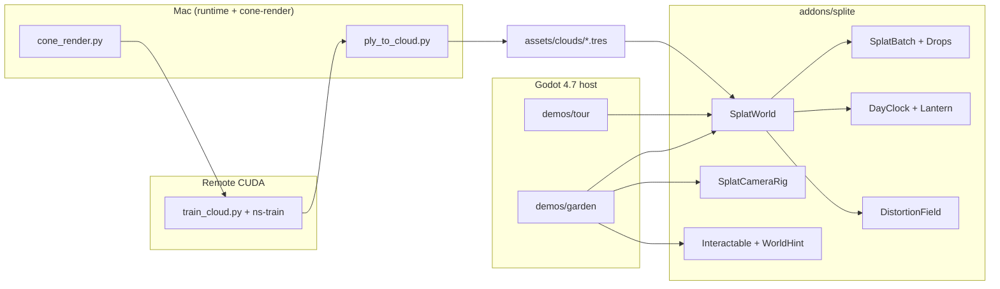
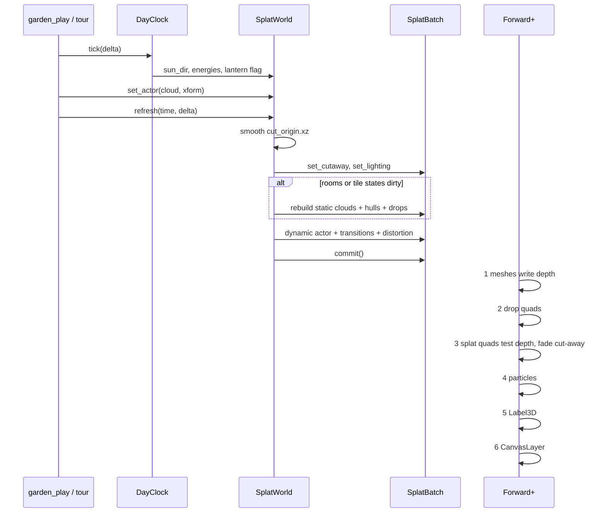
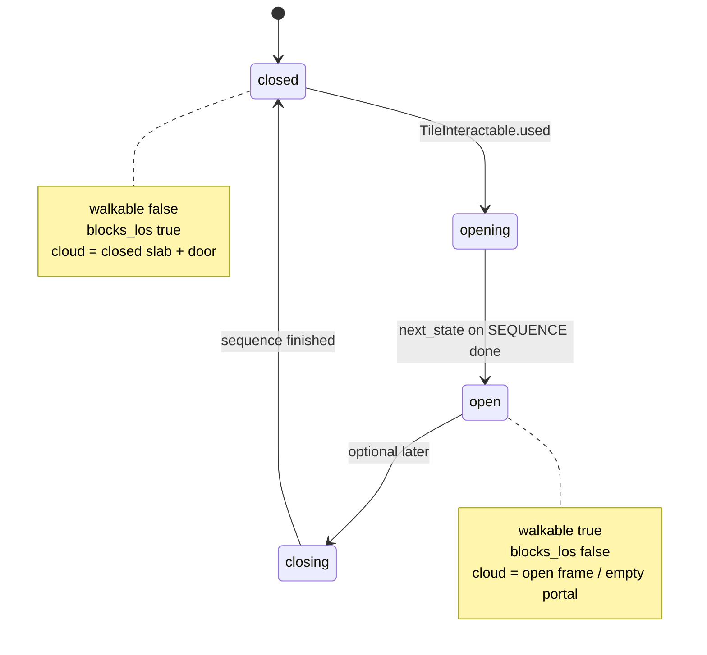
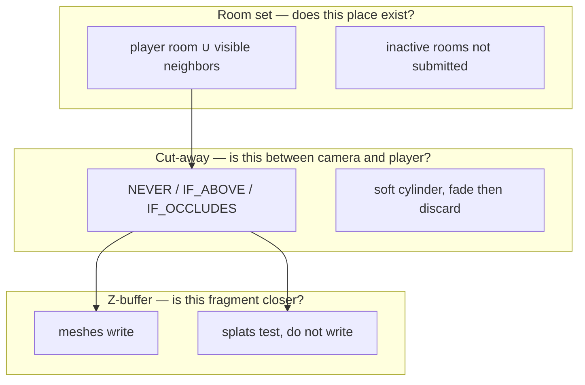

# Splite — Splat-Tile Engine for Godot 4

| Field | Value |
|---|---|
| **Document** | Architecture & implementation design |
| **Author** | wundram |
| **Date** | 2026-08-13 |
| **Status** | Draft (rev 5) |
| **Code name** | **Splite** |
| **Repo** | `/Users/wundram/dev/splite` |
| **Addon path** | `addons/splite` |
| **Host** | Godot 4.7+, macOS first, Forward+ |
| **Prototype (read-only)** | `/Users/wundram/dragon16` |
| **First deliverable** | One garden style demo + feature tour |

Long description: *Splite — a splat-tile engine for Godot.* A **splite** is the distinctive primitive: a sprite whose frames are splat clouds. The engine is bigger than that; this is the name. Do not invent a different brand. Dragon Rescue (`~/dragon16/appendix/`) is a future *consumer*, not the plugin.

---

## Overview

Splite is a publishable Godot 4.7 plugin for tile-based top-down RPG worlds (FF6 / Ultima / Rogue grammar) whose scenery and characters are authored Gaussian splat volumes, mixed with ordinary mesh polygons (floors, walls, water, doors), under a locked near-top-down perspective camera.

The prototype in `~/dragon16` already walks. It proved the camera contract, three visibility systems, hybrid mesh+splat tiles, 4pm projected drops, room-as-knowledge, distortion fields, a cellar door + ember, and a captioned feature tour. It did **not** prove production assets, temporally stable cut-away, a day/night mood, multi-state tiles, world-space hints, or a garden that looks like a place. Those are the gaps this design closes.

Implementation lives in a clean plugin at `/Users/wundram/dev/splite`. We port proven types and contracts from the prototype; we do not copy the procedural clover catalog, the pale void, the hardcoded interact, or the `dragon16` identity. The first showable artifact is **one garden scene**. Forest / temple / cathedral / neon wait.

Look: not photoreal. Tactile, representational — plastic-model Zelda (Link’s Awakening remake) + painted-matter Expedition 33. Toys that have weight.

---

## Background & Motivation

### Why this change is needed

`~/dragon16` is a research prototype that accidentally became an engine. Three identities share one folder (plugin, sandbox, future game). The catalog is programmer-art clover slabs. Playtesting the garden produced a consistent list of *feel* bugs that the current data model cannot express:

1. **Scale.** Default window is 1280×720 (`project.godot`). Camera sits at height 8.4 with 64° FOV (`SplatCameraRig`). A 1 m tile subtends ~75 px; the player is a 5-Gaussian chibi. Tiles and the character do not read.
2. **Cut-away pop.** `gaussian.gdshader` and `surface.gdshader` hard-`discard` when `cut > 0.72` and use `step()` for the height test. Large overlapping kernels vanish as wholes when the hole opens.
3. **Sky-as-tiles.** `canopy` in `catalog.gd` is a cell-sized clover blob glued on a grass slab. Environmental clouds are not cells.
4. **Asset path.** Everything is `_blob()` / `_slab()` in `SplatCatalog`. Production is CC0 model → Mac cone-render → remote-CUDA train → PLY → `SplatCloud` `.tres` checked in.
5. **Door is a flag.** `try_interact()` flips `world.walk[CELLAR_DOOR]`. The slab does not change.
6. **Lighting is noon-adjacent.** One `AFTERNOON_SUN` vector, no clock, no moon, no lantern, no night. Mesh Lambert is Godot-default; splat lighting is a baked shade in `SplatBatch._upload`.
7. **Garden is a glyph grid.** `MAPS` in `diorama.gd` is identical shrubs. No pond, no bridge, no flower variation.
8. **Hints are a corner HUD.** `prompt` is a `Label` at (16, 40).

The prototype also locked product decisions that this repo must inherit: one garden first; true top-down ~8–12° SW tilt, perspective, close + wide; Mac / 120 Hz ProMotion; relightable authored clouds (color ≈ albedo); feature tour stays; distortion stays first-class.

### Current state (prototype, facts)

| Piece | Where | What it actually is |
|---|---|---|
| Plugin | `addons/dragon16/` | 1114 lines (`*.gd` + `*.gdshader` + `plugin.cfg`); 981 GDScript; 3 shaders |
| Cloud | `core/splat_cloud.gd` | Packed isotropic Gaussians + bent-normal `shadow_vecs` |
| Tile | `core/splat_tile.gd` | One cloud, one hull, one state, enums for cut-away / cast |
| Splite | `core/splite.gd` | `clips: Dictionary` of `Array[SplatCloud]`, 10 fps |
| World | `core/splat_world.gd` | `cells: Dictionary` of `{tile, room, id}`, room set, drops, hulls |
| Batch | `render/splat_batch.gd` | Two MultiMeshes (static / dynamic), camera-facing quads |
| Drops | `render/drop_shadow_batch.gd` | Ground-aligned dark quads, hull vs blob |
| Camera | `core/camera_rig.gd` | Perspective, `look_at(..., Vector3(0,0,-1))`, practical DOF |
| Distortion | `effects/distortion_field.gd` | CPU warp of nearby Gaussians (SWIRL / BREATHE / HEAT) |
| Catalog | `core/catalog.gd` | Seeded RNG clover; 5–23 Gaussians per tile; 5-Gaussian player |
| Garden | `demos/shared/diorama.gd` | 16×14 glyph map, 4 levels, cellar torch, ember sphere |
| Tour | `demos/tour/beats.gd` | 14 captioned walking pans, then quit 0 |
| Host | `project.godot` | Features string **4.4**; README already says Godot 4.7 is at `/Applications/Godot.app`. Window 1280×720, pale clear color |

What it proved, and we keep: the three visibility systems, hybrid tiles, cast model, 4pm sun shared by `DirectionalLight3D` and the drop projector, per-splat shadow vectors, room visibility as mood, sink-into-brush as volume, feature-tour harness, `--shot=` headless capture.

What it did **not** prove: a fitted production tile, a stable cut-away, a lighting clock, tile states, world-space UI, environmental volumes, or a garden you would show someone.

---

## Goals & Non-Goals

### Goals (this design, through the first showable demo)

- A clean Godot 4.7 plugin named **Splite** at `addons/splite`, enableable by a second project.
- Runtime data model that can express multi-state tiles, environmental volumes, a day/night clock, and a lantern.
- Hybrid renderer: meshes write depth; splats test and do not write; cut-away is shared and temporally stable.
- Camera + presentation that make a character and a tile read clearly on a black void, 1920×1200 @ 120 Hz on M1 Pro.
- Interaction: interactables, tile-state transitions, floating world hints.
- Asset pipeline that is implementable on the stated hosts: Mac cone-render + importer, remote-CUDA train, checked-in `.tres` as the ship path.
- One garden style demo with variation, a pond, a bridge, a stateful door, and a feature tour that exits cleanly.
- Performance budget that 120 fps on M1 Pro is a constraint, not a wish.

### Non-goals (explicitly later)

- Forest / temple / cathedral / neon scene packs.
- Compute / hardware-raster splat backend (v1 renderer). The API is the engine; MultiMesh is replaceable.
- Anisotropic Gaussian rasterizer in the first showable demo (importer *stores* scales/rots; v0 draws isotropic).
- Tile painter editor plugin.
- Photoreal capture / phone-scan rooms / COLMAP **SfM** as the authoring path. (A *synthetic* COLMAP sparse written from known cone-render poses is the train pack, K9 — that is a file format, not a scanner.)
- Planar water that reflects *meshes* (v2). Garden pond is a mesh plane + foam cloud + distortion.
- Publishing to the Asset Library.
- Dragon Rescue as a game project.
- Replacing Godot (physics, audio, particles, input, export stay the host).
- A second brand, logo, or engine name.

---

## Key Decisions

| # | Decision | Rationale |
|---|---|---|
| K1 | **Name is Splite.** Addon `addons/splite`. Domain types keep `SplatCloud` / `SplatWorld` / `Splite` / `SplatBatch`. | “Splite” is the distinctive primitive and the publishable identity. `Splat*` is the language the prototype already taught. Do not invent a third vocabulary. |
| K2 | **One garden first.** No second biome until this scene is showable. | Product lock. Volume is the primitive we are selling; the garden is the proof. |
| K3 | **Port contracts, rewrite the model.** Camera, rooms, cast math, tour harness, distortion, hybrid draw order port. `SplatTile` as a single-state Resource, `Dictionary` cells, `SplatCatalog` clovers, hardcoded interact, pale environment do not. | The prototype API is the engine. The prototype *data shape* cannot express states, volumes, or a clock. |
| K4 | **`TileDef` + `TileState`, not a fatter `SplatTile`.** | A door is three states with a transition, not a walkable flag on one slab. |
| K5 | **Three placement kinds: cell tiles, free props, environmental volumes.** | Playtest: canopy-as-tile reads as cotton on a wall. Sky / large canopy are not grid cells. |
| K6 | **Color is albedo.** Relight in the splat shader (Lambert + ambient + lantern). Vanilla 3DGS radiance is rejected. | Day/night is a first-class mood feature. Authored under flat light. |
| K7 | **Cut-away is one function, two materials, no pop.** Soft height band, fade-then-discard, temporally smoothed origin. | Hard `step` + `discard` at 0.72 is the pop. Meshes and splats must share the hole or the lid stays in the depth buffer. |
| K8 | **v0 rasterizer stays MultiMesh camera-facing quads.** Compute backend is a later swap behind `SplatBatch`. | Prototype already proved the API is the point. Do not couple gameplay to the inner loop. |
| K9 | **Pipeline is Mac cone-render → remote CUDA splatfacto → PLY → importer.** Ship the checked-in `.tres`. Do not train on the M1 Pro. | splatfacto/gsplat are CUDA. The game host is Apple Silicon. Blender cone-render and the Godot importer run on the Mac; training does not. |
| K10 | **Default presentation: 1920×1200, black clear, camera height 6.6, SW 0.82, FOV 60° (~10° tilt).** | Playtest: tiles too small, pale void. Height 6.6 + SW 1.05 was 12.7° and broke the 8–12° contract. |
| K11 | **High-latitude sun; never zenith.** Night = moon directional + player lantern with sway and radial drops. | Noon stamps a square. Afternoon (and moon) stretch height. Lantern is the night read. |
| K12 | **World hints are `Label3D`, not a corner HUD.** HUD stays `CanvasLayer` for objective / fps / tour captions. | Playtest: contextual “Open the door” belongs on the door. |
| K13 | **Procedural catalog survives as `dev/proc_catalog.gd` only.** CI and early PRs walk without fitted assets. Production tiles come from the pipeline. | Do not block the garden scaffold on a trained tree. Do not ship clovers as the style. Fitted player is the showable *intent* (K18); proc stays the late-fit fallback. |
| K14 | **Godot 4.7, macOS first, Forward+, 120 Hz target.** Prototype’s `4.4` features string is not inherited. | Product lock. HDR output and AreaLight3D in 4.7 are available; we do not depend on them for v1. |
| K15 | **Training host is a remote CUDA box; the checked-in cloud is the ship path.** Showable garden is not gated on `tree_hero` or fitted `player_walk`. | M1 Pro cannot run `ns-train splatfacto`. A clone without CUDA still walks. Tour beat **18** (fitted tree) is skipped until the `.tres` exists. Proc chibi if `player_walk` is late (K18). Beat 17 is day/night + lantern and ships in PR12. |
| K16 | **`SplatVolumeDef` is a Resource; `SplatVolume` is a Node3D that instances a def.** | Node3Ds are not `.tres`. Garden places nodes; `assets/volumes/*.tres` holds defs. |
| K17 | **Environment is a black void.** `BG_COLOR` near-black, fog off, no pale fill light, no oversized ground plane. | Porting `diorama.gd` `_environment()` / `_ground()` recreates the pale box the playtest rejected. |
| K18 | **Fitted player is intended for the showable demo; shop Poly Haven CC0 first.** Same cone-render pipeline as `tree_hero`, N walk-cycle frames (`player_walk`). Sketchfab CC-BY is backup. Procedural chibi stays in `dev/proc_catalog.gd` as the late-fit fallback — same pattern as the tree. | Open Q1/Q2. A clover-chibi is the thing a viewer cannot see past. Do not gate the garden on CUDA; do intend to swap the fitted `Splite` in when the `.tres` exists. |

---

## Proposed Design

### 1. Repo / addon layout

```
/Users/wundram/dev/splite/
  README.md                         (exists)
  project.godot                     Godot 4.7 host for demos
  icon.svg
  addons/splite/                    THE PLUGIN (this is the engine)
    plugin.cfg
    plugin.gd
    core/
      splat_cloud.gd
      tile_def.gd                   class_name TileDef (one per file)
      tile_state.gd                 class_name TileState
      tile_surface.gd               class_name TileSurface
      splat_volume_def.gd           Resource: cloud, kind, cutaway, cast
      splat_volume.gd               Node3D wrapper that applies a def
      splite.gd
      splat_world.gd
      camera_rig.gd
      splite_actor.gd
      day_clock.gd
      lantern.gd
    render/
      splat_batch.gd
      drop_shadow_batch.gd
      gaussian.gdshader
      surface.gdshader
      drop_shadow.gdshader
      cutaway.gdshaderinc            shared include
    effects/
      distortion_field.gd
    interaction/
      interactable.gd
      tile_interactable.gd
      world_hint.gd
    editor/                         empty until a tile painter
    dev/
      proc_catalog.gd               procedural stand-ins for CI / early PRs
  demos/
    shared/
      garden.gd                     one map, both consumers
      garden_catalog.gd             production tile ids (fitted + stand-in)
    garden/
      garden.tscn                   playable style demo (main scene)
      garden_play.gd
    tour/
      tour.tscn
      tour.gd
      feature_tour.gd
      beats.gd                      living reel — add a beat when a feature ships
  tools/pipeline/                   not a Godot addon; CLI next to the project
    README.md
    blender/cone_render.py          Blender 4.x operator / script
    train/train_cloud.py            thin splatfacto / gsplat wrapper
    import/ply_to_cloud.py          PLY → SplatCloud .res (+ optional .gd importer)
    recipes/tree_hero.toml          first implementable recipe
    recipes/player_walk.toml        N walk-cycle frames; same pipeline (K18)
  assets/
    ATTRIBUTION.md                  license + URL for every source
    sources/                        original glTF / blend (git-LFS if large)
    captures/<id>/                  cone-render output (images + transforms.json)
    clouds/<id>.ply                 trained
    clouds/<id>.res                 imported SplatCloud
    tiles/                          TileDef .tres
    splites/                        Splite .tres
    volumes/                        SplatVolumeDef .tres
  docs/
    design.md                       this document, copied in when the repo is seeded
    splat-tile-engine.md            ported contract (updated names)
  appendix/                         empty; Dragon Rescue stays in the prototype repo
```

A game that consumes Splite is a **second Godot project** that enables `addons/splite`. The garden demo is the engine’s walkable unit test. `tools/pipeline` is deliberately outside the addon so a machine without Blender/CUDA can still run the game.

`addons/splite/plugin.cfg`:

```ini
[plugin]
name="Splite"
description="Splite — a splat-tile engine for Godot."
author="wundram"
version="0.1.0"
script="plugin.gd"
```

`plugin.gd` registers custom types only after their scripts exist (same `preload` pattern as `~/dragon16/addons/dragon16/plugin.gd`). **PR1 registers zero types** — `_enter_tree` / `_exit_tree` are empty — so the addon enables on a README-only tree. Each later PR adds its own `add_custom_type` / `remove_custom_type` pair.

Custom types (once all PRs land): `SplatWorld`, `SplatBatch`, `SplatCameraRig`, `SpliteActor`, `DistortionField`, `SplatVolume`, `DayClock`, `Interactable`, `TileInteractable`, `WorldHint`. Resources stay `class_name` only: `SplatCloud`, `TileDef`, `TileState`, `TileSurface`, `SplatVolumeDef`, `Splite`.

Shader load paths become `res://addons/splite/render/...`. That is the only path break from the prototype.

### 2. Runtime data model

```
SplatCloud        packed Gaussians (albedo, not radiance)
TileDef           named states + default
  TileState       one visual + gameplay configuration + next_state
  TileSurface     optional visible mesh (box-from-hull or authored Mesh)
SplatVolumeDef    Resource: cloud, kind, cutaway, cast, lod, room
SplatVolume       Node3D that applies a SplatVolumeDef
Splite            named clips of SplatCloud frames
SplatWorld        grid[level][cell] → Cell; rooms; volumes; clock
Cell              TileDef + current state + room + transition
SpliteActor       instance of a Splite + facing + clip clock
DayClock          high-latitude sun / moon / ambient
Lantern           player omni + sway + radial drops
DistortionField   world-space warp
Interactable      prompt + verb + enable
WorldHint         Label3D in the scene
```

#### 2.1 `SplatCloud` — extend, do not flatten

Port `~/dragon16/addons/dragon16/core/splat_cloud.gd`. Add optional anisotropy and an albedo contract. v0 renderer still draws isotropic quads.

```gdscript
class_name SplatCloud
extends Resource
## Authored Gaussians. color[] is albedo (flat-lit), never baked radiance.

@export var positions: PackedVector3Array
@export var radii: PackedFloat32Array          # isotropic fallback = exp(mean(log-scale))
@export var colors: PackedColorArray           # RGB albedo; A ignored on the resource
@export var opacities: PackedFloat32Array      # post-sigmoid, 0..1 (uploaded into instance_color.a)
@export var shadow_vecs: PackedVector3Array    # bent-normals; filled if empty
@export var aabb: AABB

# Optional; empty in procedural stand-ins. Importer fills from PLY.
@export var scales: PackedVector3Array         # linear (not log)
@export var rotations: PackedVector4Array      # quaternion xyzw
@export var source_id: String                  # recipe id + ply hash
```

`recompute_aabb()` and `_fill_shadow_vecs()` port as-is (centroid + Y lift 0.35). Importer may overwrite `shadow_vecs` from covariance orientation later; v0 centroid heuristic is fine.

Budget: hundreds per tile, not millions. See § Performance.

#### 2.2 `TileDef` / `TileState` — replaces `SplatTile`

`SplatTile` in the prototype is a single visual plus flags. A door needs `closed / opening / open`. Split. GDScript allows **one** `class_name` per file, so three scripts:

| File | `class_name` |
|---|---|
| `core/tile_def.gd` | `TileDef` |
| `core/tile_state.gd` | `TileState` |
| `core/tile_surface.gd` | `TileSurface` |

```gdscript
# tile_def.gd
class_name TileDef
extends Resource

enum Cutaway { NEVER, IF_ABOVE, IF_OCCLUDES }
enum CastModel { NONE, HULL, BLOB }

@export var id: StringName
@export var default_state: StringName = &"default"
@export var states: Dictionary[StringName, TileState] = {}
@export var tags: PackedStringArray = []  # "floor", "door", "water", "stair"
```

```gdscript
# tile_state.gd
class_name TileState
extends Resource

@export var display_name: String = ""
@export var cloud: SplatCloud
@export var surface: TileSurface
@export var hull: AABB = AABB(Vector3(-0.5, 0.0, -0.5), Vector3(1.0, 0.2, 1.0))
@export var walkable: bool = true
@export var blocks_los: bool = false
@export var cast_model: TileDef.CastModel = TileDef.CastModel.NONE
@export var receive_shadow: bool = true
@export var cast_height_override: float = -1.0
@export var cutaway: TileDef.Cutaway = TileDef.Cutaway.NEVER
@export var cutaway_top: float = -1.0
@export var enter_duration: float = 0.0          # CROSSFADE only: seconds blend 0→1
@export var enter_mode: int = 0                  # 0 CROSSFADE, 1 SEQUENCE
@export var sequence: Array[SplatCloud] = []     # used when SEQUENCE
@export var sequence_fps: float = 10.0           # SEQUENCE clock; wall time = size/fps
@export var next_state: StringName = &""         # empty = stay; opening.next_state = &"open"
```

```gdscript
# tile_surface.gd
class_name TileSurface
extends Resource

@export var visible: bool = false
@export var color: Color = Color(0.55, 0.55, 0.58)
@export var mesh: Mesh                  # null → BoxMesh from hull
@export var roughness: float = 0.88
```

Gameplay truth is always the **current state’s** hull / walkable / blocks_los. During CROSSFADE, walkable and blocks_los switch at `t = 0.5`. During SEQUENCE (door opening), walkable and blocks_los stay on the *from* state until `next_state` is entered.

A cell at runtime:

```gdscript
# Not a Resource. Lives in SplatWorld.cells.
class Cell:
    var def: TileDef
    var room: StringName
    var state: StringName
    var from_state: StringName
    var blend: float          # 0 = from, 1 = to
    var seq_time: float
```

`SplatWorld.set_cell_state(level, x, z, to_state)` starts a transition into `to_state`. `refresh()` submits either one cloud or two (crossfade, modulate.a = 1-blend / blend). SEQUENCE submits `sequence[int(seq_time * fps)]`.

**Two clocks, do not mix them.**

| `enter_mode` | Clock | `enter_duration` |
|---|---|---|
| CROSSFADE | `blend` goes 0→1 over `enter_duration` | **used** |
| SEQUENCE | `seq_time * sequence_fps`; done when `>= sequence.size()` | **ignored** |

Door opening is SEQUENCE: 4 frames at 10 fps = **0.40 s**. Set `opening.enter_duration = 0.0` so nobody treats it as the clock.

**Automatic successor.** When SEQUENCE plays through (`seq_time * fps >= sequence.size()`) or CROSSFADE reaches `blend >= 1.0`, if `TileState.next_state != &""`, `SplatWorld` enters that state, sets `_needs_static`, and emits `state_finished(cell_key, from, to)`. Empty `next_state` means stay. Garden code does not hardcode `opening → open`.

Door graph (data, not garden script):

```
closed.next_state     = &""         # wait for Interactable
opening.enter_mode    = SEQUENCE
opening.sequence_fps  = 10
opening.enter_duration = 0.0        # unused (SEQUENCE)
opening.next_state    = &"open"     # 4 frames → 0.40 s, then open
open.next_state       = &""
```

`TileInteractable.used` only calls `set_cell_state(..., &"opening")`.

Compatibility: a one-state tile (`default` only, `next_state` empty) is the prototype `SplatTile`. `dev/proc_catalog.gd` builds those.

**`cast_shadow` is retired.** Prototype `SplatTile.cast_shadow` defaults true, so even grass spawned a shadows-only `BoxMesh`. Splite hull meshes exist only when `TileSurface.visible` is true. Splat-only tiles cast via `cast_model` drops, never via Godot directional casters.

#### 2.3 `Splite`

Port `splite.gd`. Add facing policy and an optional per-clip hitbox override. Do not invent 4DGS.

```gdscript
class_name Splite
extends Resource

enum Facing { FLIP_Y, FOUR_DIR, EIGHT_DIR }  # v1 garden uses FLIP_Y

@export var id: StringName
@export var fps: float = 10.0
@export var hitbox: AABB
@export var shadow_hull: AABB
@export var cast_model: TileDef.CastModel = TileDef.CastModel.BLOB
@export var receive_shadow: bool = false
@export var cast_height: float = 0.72
@export var facing_mode: Facing = Facing.FLIP_Y
@export var clips: Dictionary = {}   # StringName -> Array[SplatCloud]
```

Animation contract, unchanged from `docs/splat-tile-engine.md` §7:

| Thing | Rate |
|---|---|
| Camera, entity motion, lights, distortion, particles | display refresh (120 Hz) |
| Splite *frames* | 8–15 fps, on purpose |
| Otherworldly / dragons (later) | more frames, even continuous |

A walk cycle is N clouds (the proc stand-in is four). Intent is N cone-fits of a posed CC0 model (`player_walk`, K18). `dev/proc_catalog.gd::_figure` is the late-fit / CI fallback. The runtime does not care.

#### 2.4 Environmental volumes — not tiles

Playtest: the current `canopy` tile is a cotton ball on a grass cell. Large canopy and sky are independently placed volumes.

Two types (K16). `.tres` files are defs. The garden scene places nodes.

```gdscript
# splat_volume_def.gd — Resource, PR2
class_name SplatVolumeDef
extends Resource

enum Kind { PROP, CANOPY, SKY, ATMOS }

@export var id: StringName
@export var cloud: SplatCloud
@export var kind: Kind = Kind.PROP
@export var cutaway: TileDef.Cutaway = TileDef.Cutaway.NEVER
@export var cutaway_top: float = -1.0
@export var cast_model: TileDef.CastModel = TileDef.CastModel.NONE
@export var cast_height: float = 0.0
@export var room: StringName = &""     # empty + SKY/ATMOS → submitted when OUTSIDE is active
@export var lod_radius: float = 24.0
```

```gdscript
# splat_volume.gd — Node3D, PR10
class_name SplatVolume
extends Node3D

@export var def: SplatVolumeDef
# transform, visible, and room override live on the node
```

| Kind | Placement | Room cull | Cut-away | Cast | Scale |
|---|---|---|---|---|---|
| **PROP** | free, often 1–2 cells | yes | optional IF_OCCLUDES | blob/hull | ~1 tile |
| **CANOPY** | free, spans 2–5 tiles | yes (OUTSIDE) | IF_OCCLUDES | wide blob | 2–4 tiles |
| **SKY** | free, large, above the map | only if OUTSIDE is active | NEVER | none | 8–20 tiles |
| **ATMOS** | thin volume (mist over pond) | yes | NEVER | none | 2–6 tiles |

Tiles remain the *ground grammar* (walk, rooms, stairs, doors). Volumes are *dressing and sky*. A tree in the garden is: trunk **tile** (walkable, blob cast) + one **CANOPY** volume (not a 3×3 of canopy tiles). Sky is one or two SKY volumes, possibly procedural noise-warped in a later PR — never a row of cell-sized clouds.

`SplatWorld` holds `volumes: Array[SplatVolume]` (nodes). Submission reads each node's `def` and world transform, same batch as tiles. SKY/ATMOS skip the static MultiMesh if they animate (wind); otherwise they are static. PR6 does **not** place a volume node — trunk tile only — until PR10.

#### 2.5 Lights

```gdscript
class_name DayClock
extends Node

## Hours in [0, 24). Keyframed path; elevation clamped so the sun never reaches zenith.
@export var time: float = 16.0                 # start at 4pm — the proven look
@export var day_length_sec: float = 180.0      # 3 min full cycle when not paused; must be > 0
@export var paused: bool = true                # v1 default: hold 16:00. Unpause to run the cycle.
@export var scrub_enabled: bool = true         # [ / ] in the garden demo. Only pause switch.

func sun_dir() -> Vector3      # unit vector *toward* the sun
func moon_dir() -> Vector3
func sun_energy() -> float     # 0 at night
func moon_energy() -> float
func ambient_color() -> Color
func ambient_energy() -> float
func sun_color() -> Color
func phase() -> int            # DAWN, DAY, DUSK, NIGHT
func is_night() -> bool
```

Sun path is a **piecewise keyframe curve**, not a closed-form solar model. The 16:00 knot is exactly the prototype vector. An engineer who implements `sin(el) = sin(lat)sin(dec)+…` will ship a different 4pm than the look we are required to match; do not.

`SplatWorld.AFTERNOON_SUN` stays `Vector3(-0.76, 0.54, -0.35)` (WNW, elevation `asin(0.54/‖v‖) ≈ 33°`).

| Knot | `time` | `dir` (toward light) | Energy | Color | Ambient color / energy |
|---|---|---|---|---|---|
| Dawn | 5.5 | `Vector3(0.78, 0.28, -0.22).normalized()` (ENE, ~16°) | 0.45 | `(1.00, 0.62, 0.48)` | `(0.45, 0.48, 0.62)` / 0.16 |
| Afternoon | **16.0** | **`AFTERNOON_SUN` exactly** | **1.35** | `(1.00, 0.78, 0.52)` | `(0.55, 0.50, 0.48)` / 0.28 |
| Dusk | 20.0 | `Vector3(-0.84, 0.22, 0.12).normalized()` (W, ~13°) | 0.35 | `(1.00, 0.48, 0.28)` | `(0.28, 0.24, 0.32)` / 0.12 |
| Night | 23.0 | moon `Vector3(0.42, 0.64, 0.54).normalized()` (~40°) | 0.18 | `(0.70, 0.78, 1.00)` | `(0.12, 0.14, 0.22)` / 0.07 |

Interpolate `dir` (slerp), energy, and colors between knots. Between dusk and dawn the directional is the moon. Clamp any interpolated elevation to `[8°, 55°]` while the sun is up (never zenith). Azimuth over a day runs **E → W** (dawn ENE, 16:00 WNW, dusk W). Background stays the K17 black; only ambient energy lifts.

`[` / `]` scrub `time` by ±0.5 h per tap (InputMap actions `splite_time_back` / `splite_time_fwd`, physical `[` / `]`). Bound in `garden_play.gd` (PR9), not in the plugin.

`DayClock` writes:

- `SplatWorld.sun_dir` (day) or `moon_dir` (night) — **same vector** the drop projector uses.
- `DirectionalLight3D` basis (`Basis.looking_at(-toward, Vector3.UP)`, port `_aim_sun()`).
- `Environment.ambient_light_color` and `ambient_light_energy` only. **Never writes `background_color`.** That is set once in PR6’s `WorldEnvironment` to `(0.015, 0.016, 0.020)` and stays there (K17). Ambient lifts; the void does not become beige.
- `Lantern.enabled` when `is_night()` or the player is in a dark interior.

```gdscript
class_name Lantern
extends Node3D
## Child of SpliteActor. Omni + handheld sway + radial drop requests.

@export var energy: float = 2.2
@export var color: Color = Color(1.0, 0.72, 0.38)
@export var omni_range: float = 5.5
@export var sway_amp: float = 0.045
@export var sway_hz: float = 1.35
@export var drop_radius: float = 4.0
```

Each frame the lantern (a) offsets its `OmniLight3D` by `sin/cos` sway in player-local XZ, (b) asks `DropShadowBatch` for a small set of **radial** blobs: for each nearby `receive_shadow` cell, project a blob along `receiver - lantern` onto that plane, strength `∝ 1/r²`, capped at 12 dynamic drops. This is not a shadow map. It is the same cheap language as the 4pm projector, just omnidirectional.

Cellar torch stays a room-scoped `OmniLight3D` (already in `diorama.gd`). It exists only when `CELLAR_IN` is active. Light is knowledge. **v1 splat Lambert has one directional + one lantern.** Mesh Omni lights (torch, any future lamp) light **meshes only**. Plank dressing in the cellar does not receive the torch. That is an accepted v1 gap, not a packing puzzle.

### 3. Renderer

#### 3.1 Draw order (v1 amendment)

Prototype contract (`splat-tile-engine.md` §4b) is mesh → splats → transparents → UI. Splite inserts drop quads and world labels:

```
1. Opaque mesh surfaces (floors, walls, water plane, authored tile meshes). Depth write ON.
2. Drop quads (depth test, no write).  drop ShaderMaterial.render_priority = -1
3. Splat clouds (depth test ON, depth write OFF).  gaussian ShaderMaterial.render_priority = 0
4. Transparents / particles / distortion aftermath.
5. World Label3D (depth test ON, optional).
6. CanvasLayer UI (HUD, tour captions).
```

`render_priority` lives on **`ShaderMaterial`**, not on `MultiMeshInstance3D` (`GeometryInstance3D` has `sorting_offset`, which we do not set in v1). PR3 sets `_mat.render_priority = -1` on the drop material and `0` on the gaussian material. Both shaders are `blend_mix` + `depth_draw_never`; without the material priority, Godot may draw drops on top of grass. If a reviewer still sees drops over grass after that, then — and only then — try `sorting_offset`; Forward+ transparent sort is not guaranteed by priority alone.

Cut-away is a **discard in steps 1 and 3**, so the hole is in the depth buffer. The player is not “drawn on top”; the lid is gone.

Splats never write depth. Soft kernels writing depth ate the player in the prototype; that finding stands.

#### 3.2 Hybrid tile

A `TileState` may have `surface.visible` and/or `cloud`. Same authoring unit, two draw paths — this is the prototype’s best idea. Floors, walls, stairs, water, doors: mesh (hard plane, receives light/shadow, writes depth). Grass, brush, characters, grit, moss, flowers: cloud.

Water and mirrors stay mesh. A Gaussian has no surface to bounce a ray off, and our clouds are authored for a downward cone. Garden pond = `PlaneMesh` + `DistortionField` (HEAT or a new RIPPLE) + a foam `SplatVolume` (ATMOS). Do not chase photoreal splat undersides.

#### 3.3 Cut-away without pop

**Severity of the current bug: High.** `gaussian.gdshader` lines 41–49:

```glsl
float above = step(cutaway_origin.y + 0.25, v_hull_top);
float d = length(v_world.xz - cutaway_origin.xz);
float ring = 1.0 - smoothstep(cutaway_inner, cutaway_outer, d);
cut = above * ring;
if (cut > 0.72) { discard; }
ALPHA = g * v_opacity * COLOR.a * (1.0 - cut);
```

Three pops: (1) `step()` on height — stairs flip whole slabs, (2) `discard` at 0.72 — large kernels vanish as wholes, (3) cut evaluated at the camera-facing **billboard** `v_world`, so a wide Gaussian whose center is outside the hole still pops when a fragment crosses 0.72.

**Fix — one include, two materials, one origin.**

`addons/splite/render/cutaway.gdshaderinc`:

```glsl
uniform vec3  cut_origin;     // temporally smoothed player XZ, head Y
uniform float cut_inner;      // default 1.45
uniform float cut_outer;      // default 2.90
uniform float cut_y_soft;     // default 0.22 — replaces step()
uniform float cut_y_bias;     // default 0.25 — prototype head bias, kept

float cutaway_amount(vec3 world, float policy, float hull_top) {
    if (policy < 0.5) return 0.0;
    float above = smoothstep(cut_origin.y + cut_y_bias,
                             cut_origin.y + cut_y_bias + cut_y_soft,
                             hull_top);
    float d = length(world.xz - cut_origin.xz);
    float ring = 1.0 - smoothstep(cut_inner, cut_outer, d);
    return clamp(above * ring, 0.0, 1.0);
}
```

Inner/outer are 1.45 / 2.90, up from the prototype world’s 1.35 / 2.70 (shader defaults were 1.3 / 2.6). The camera is closer (6.6 vs 8.4), so the same world-space hole reads smaller on screen; the bump keeps the dollhouse bite at roughly the prototype’s screen radius.

**One function, two evaluation points, no “or”.**

Splat fragment:

1. `v_center` = Gaussian center (`MODEL_MATRIX[3].xyz` before the camera-facing expand).
2. `cut_center = cutaway_amount(v_center, policy, hull_top)` — drives fade.
3. `cut_frag   = cutaway_amount(v_world,  policy, hull_top)` — fragment of the billboard.
4. `ALPHA *= (1.0 - cut_center)`.
5. `discard` if `cut_frag > 0.95` **or** `ALPHA < 0.02`.

Center fade stops the 0.72 pop. Fragment discard stops a 0.4–0.85 m kernel whose center is *outside* the cylinder from painting back across the hole (the leak that fitted trees will hit).

Mesh fragment (opaque core, **no** ALPHA fade — `depth_draw_opaque` plus mid-band ALPHA writes a lid that eats the player):

- `discard` when `cutaway_amount(v_world, policy, hull_top) > 0.85`.
- Otherwise fully opaque. Rim is a hard-ish dollhouse bite ~0.15 tiles inside `cut_outer`, not a transparent skirt.

Optional look knob: world-stable hashed dither in the splat mid-band (`hash(splat_index) < cut_center`). Default **off**. Involuntary dither crawl is a bug (`splat-tile-engine.md` §8.5); turn it on only if the fade reads mushy.

PR7 is not done until a reviewer walks under the walkway **and** under a large-kernel canopy (proc stand-in ≥ 0.6 m radius is enough if `tree_hero` is not in yet).

**Temporal origin.** `SplatWorld.refresh()` does **not** feed the raw actor head. It exponential-smooths XZ:

```gdscript
_cut_xz = _cut_xz.lerp(actor_xz, 1.0 - exp(-14.0 * delta))  # ~14 Hz follow
_cut_y  = actor_head.y   # Y follows stairs immediately — a lagging lid is worse
```

Radius (`cutaway_inner` / `outer`) is a look knob, not a gameplay flicker source. Do not rebuild the static MultiMesh when the player moves; cut-away is already a uniform (prototype got this right).

Policy meanings port unchanged from `splat-tile-engine.md` §4b:

| Policy | Measure | Use |
|---|---|---|
| `NEVER` | — | floor you stand on, water, ground cover |
| `IF_ABOVE` | hull *floor* world Y | higher-level floors, roofs, walkways |
| `IF_OCCLUDES` | visual *top* | canopies / tall props; same-level tree can still open |

Room set stays a different system. Do not collapse them.

#### 3.4 Relighting (v0, authored albedo)

Vanilla 3DGS stores radiance in SH. We will not. The importer keeps `f_dc` only (see § Pipeline) and treats it as albedo.

**Frozen MultiMesh packing** (PR3 ships it; PR9 only adds uniforms). Godot MultiMesh gives one `Color` + one custom `Color`. Prototype packing `(radius, opacity, policy, hull_top)` cannot carry a shadow vector. New layout:

| Channel | Contents |
|---|---|
| `instance_color.rgb` | albedo |
| `instance_color.a` | opacity (from `SplatCloud.opacities[i]`) |
| `instance_custom.r` | radius |
| `instance_custom.g` | oct-encoded shadow_vec.x in `[0,1]` |
| `instance_custom.b` | oct-encoded shadow_vec.y in `[0,1]` |
| `instance_custom.a` | `float(policy) + fract(hull_top / 8.0)` — policy ∈ {0,1,2} in the integer part; hull_top in world metres packed as `hull_top/8` in the fraction (hull_top ∈ [0, 8) is enough for this camera) |

Oct encode/decode is the standard octahedron map (`n.xy / (abs(n.x)+abs(n.y)+abs(n.z))`, fold if `n.z < 0`).

Vertex shader (new varyings the prototype does not have):

```glsl
varying vec3  v_center;   // MODEL_MATRIX[3].xyz
varying vec3  v_shadow;   // decoded unit bent-normal
varying vec3  v_world;    // billboard fragment world pos
varying float v_opacity;
varying float v_policy;
varying float v_hull_top;
```

Lambert lives in the fragment shader from PR3, with `lantern_energy` defaulting to 0 until PR9:

```glsl
uniform vec3  light_dir;
uniform vec3  light_color;
uniform float light_energy;
uniform vec3  ambient_color;
uniform float ambient_energy;
uniform vec3  lantern_pos;
uniform vec3  lantern_color;
uniform float lantern_energy;   // 0 until PR9
uniform float lantern_range;
uniform float saturate;
uniform float lift;

vec3 albedo = COLOR.rgb;
float ndotl = clamp(dot(v_shadow, light_dir), 0.0, 1.0);
vec3 lit = ambient_color * ambient_energy
         + light_color * light_energy * (0.40 + 0.60 * ndotl);
if (lantern_energy > 0.01) {
    vec3 L = lantern_pos - v_center;
    float r = length(L);
    float att = clamp(1.0 - r / lantern_range, 0.0, 1.0);
    att *= att;
    lit += lantern_color * lantern_energy * att
        * (0.35 + 0.65 * clamp(dot(v_shadow, L / max(r, 0.001)), 0.0, 1.0));
}
float luma = dot(albedo * lit, vec3(0.299, 0.587, 0.114));
ALBEDO = mix(vec3(luma), albedo * lit, saturate) + lift;
ALPHA = g * v_opacity * (1.0 - cut_center);
```

`softness`, `saturate`, and `lift` are all `SplatBatch` exports. Prototype only exported softness + saturate; `lift` was a shader default (0.02). Promote it.

Do not CPU-bake shade into instance color. Do not rebuild the static MultiMesh when the clock ticks. Mesh Omni lights still do not appear in this shader (see §2.5).

#### 3.5 Drop shadows

Port `DropShadowBatch` and `drop_shadow.gdshader`. Cast math ports from `SplatWorld._ground_offset` / `_receiver_y` / `_rebuild_static_drops`:

```
offset_xz = (-sun.x / sun.y, -sun.z / sun.y) * lift
lift      = caster_top - highest receive_shadow plane beneath
```

`sun.y` is clamped to `≥ 0.15` (already in `_sun()`). Combined with the high-latitude clock, we never divide by a zenith.

Three pieces, still separate:

| Piece | Who | What |
|---|---|---|
| Cast model | tile state / splite / volume | `none` / `hull` / `blob` |
| Receive flag | mesh surfaces and ground | drops land here; splat dressing does not receive in v0 |
| Shadow vector | each Gaussian | self-shadow / volume, not a drop |

Night: the same projector uses `moon_dir`. Lantern adds radial blobs (see §2.5). Godot directional shadows on visible hulls stay as contact/ambient on mesh slabs; they are not the dimensionality cue.

#### 3.6 Distortion

Port `DistortionField` unchanged (SWIRL / BREATHE / HEAT). Apply to volumes too. Tiles near a field skip the static MultiMesh and go through `_add_distorted` (prototype pattern). GPU-in-shader warp is later; CPU warp of a few hundred Gaussians in a 1.7 m puddle is fine.

A 2D pixel sprite cannot occupy a warped volume. This is why the primitive swap is worth it. Distortion stays first-class.

#### 3.7 Sorting

Prototype `SplatBatch._upload` does **not** sort. Splite does, in PR3:

- Dynamic MultiMesh (actor, transitions, distorted tiles, volumes that moved): back-to-front by AABB center along the view ray, rebuilt each frame. Cheap at < 20 dynamic clouds.
- Static MultiMesh (floor tiles): shared order, insertion = paint order. No per-frame sort.
- Drop `ShaderMaterial.render_priority = -1`, gaussian `ShaderMaterial.render_priority = 0`. Not a node property.

Stochastic hashed-alpha is a look knob, default off for the garden (involuntary crawl is a bug).

### 4. Camera & presentation

Port `SplatCameraRig` with new defaults. World −Z is north / screen-up. `look_at(focus, Vector3(0, 0, −1))` stays — `Vector3.UP` yaws the map 45° when the view is nearly vertical (comment in `camera_rig.gd`).

| Knob | Prototype | Splite default | Why |
|---|---|---|---|
| Window | 1280×720 | **1920×1200** | 16:10, readable tiles on a 14–16" Mac |
| Clear / BG | `Color(0.55, 0.62, 0.68)` + env `0.72, 0.62, 0.58` | **`Color(0.015, 0.016, 0.020)`** | Playtest: black void, not a pale box |
| Height | 8.4 | **6.6** | Closer |
| South / west | 1.25 / 1.25 | **0.82 / 0.82** | 10° SW tilt at height 6.6 |
| FOV | 64° | **60°** | Slightly tighter; still shears |
| Near / far | 0.25 / 48 | 0.20 / 40 | Tighter far; sky volumes live inside it |
| Follow | exp 8.0 | 8.0 | Keep |
| DOF amount | 0.028 | **0.034** | Tilt-shift miniature, still subtle |
| Stretch | `canvas_items` + expand | **disabled for 3D**; HUD uses a `CanvasLayer` that ignores stretch | 3D should be native pixels on ProMotion |

Quantified read: camera distance `√(6.6² + 0.82² + 0.82²) ≈ 6.70`. A 1 m tile at the look-at point subtends `2·atan(0.5/6.70) ≈ 8.5°` → `8.5/60 * 1200 ≈ 171 px` (the 168 px claim survives a smaller SW). A 0.72 m character ≈ 123 px. Prototype: ~75 px tile, ~54 px character. That is the scale fix.

Tilt is `atan(√(0.82²+0.82²) / 6.6) = atan(1.160 / 6.6) ≈ 10.0°`, inside the 8–12° contract. (Height 6.6 + SW 1.05 was 12.7° and out of contract; prototype 8.4 / 1.25 is 11.9°.) View cone stays well inside ±30° of vertical. No undersides, no horizon.

`CameraAttributesPractical` DOF stays (near + far) to get the plastic-model tilt-shift. Do not write a custom tilt-shift shader in v1; Godot’s practical DOF is the proven path in the prototype.

World scale contract, unchanged: **one tile = one world unit = one meter** in the pipeline. A roof tile is the same asset from the ground or from a higher ledge; perspective shrinks it.

`project.godot`:

```
[application]
config/name="Splite"
run/main_scene="res://demos/garden/garden.tscn"
config/features=PackedStringArray("4.7")

[display]
window/size/viewport_width=1920
window/size/viewport_height=1200
window/vsync/vsync_mode=1
# stretch off — 3D is native

[rendering]
renderer/rendering_method="forward_plus"
anti_aliasing/quality/msaa_3d=2
environment/defaults/default_clear_color=Color(0.015, 0.016, 0.02, 1)
```

**Environment contract (K17), applied in PR1 (clear color) and PR6 (`WorldEnvironment`):**

| Knob | Prototype `_environment()` / `_ground()` | Splite |
|---|---|---|
| `background_mode` | `BG_COLOR` | `BG_COLOR` |
| `background_color` | `(0.72, 0.62, 0.58)` | `(0.015, 0.016, 0.020)` |
| Fog | on, density 0.008, light `(0.72, 0.76, 0.80)` | **off** |
| Fill `DirectionalLight3D` | blue, energy 0.22 | **absent** |
| Ground `PlaneMesh` 16.2×14.2 | green at y=−0.04 | **absent** — painted tiles are the ground |
| SSAO | on | on (unchanged) |
| Tonemap | filmic | filmic |
| Glow | 0.08 | 0.08 or off; must not lift the void to beige |
| Ambient | `(0.78, 0.68, 0.58)` × 0.38 | DayClock table (§2.5); never writes `background_color` |

Target 120 Hz on ProMotion: vsync on, no frame cap, physics 60 Hz with interpolation (Godot 4 default). Splite frames stay 10 fps.

### 5. World, rooms, movement

Port the `(level, x, z) → cell` grid, `level_height = 1.25`, stair interpolation, and room-as-knowledge rule.

**Type the cell dictionary.** Prototype `cells: Dictionary` of untyped `{tile, room, id}` becomes `Dictionary[Vector3i, Cell]`. `walk` is derived from the current state’s `walkable` and rebuilt on state change.

Room set, unchanged semantics:

```
active set = player's room ∪ rooms they can currently see through
inactive rooms are not submitted
a torch in a sealed cellar does not exist
```

Garden rooms port: `OUTSIDE`, `CELLAR_IN`, `CWALLS`, `HOUSE_IN`, `HWALLS`, `ROOFH`. Visibility table ports from `DemoDiorama._update_room()`.

Stairs port `STAIRS` + `_update_stairs()` (N-exit, 2-tile span, fractional elevation). Walking along a stair run interpolates `elev`; `player_level` flips at 0.5.

Actor movement ports `try_move` (axis-separated, 4-corner footprint). Corners are taken from the `Splite.hitbox`, not the prototype’s magic `±0.16 / ±0.12`:

```gdscript
var hx := splite.hitbox.size.x * 0.5
var hz := splite.hitbox.size.z * 0.5
# default hitbox size (0.36, 0.72, 0.36) → ±0.18, ±0.18
var corners := [Vector2(-hx, -hz), Vector2(hx, -hz), Vector2(-hx, hz), Vector2(hx, hz)]
```

`SplatWorld.refresh(time, delta)` grows a dirty-flag set:

| Flag | Rebuilds |
|---|---|
| `_needs_static` | static MultiMesh + static drops + hull meshes (room change, tile paint, tile state finished) |
| `_needs_dyn` | actor, transitioning tiles, distorted tiles, lantern drops |
| `_needs_lights` | clock tick or lantern move past epsilon → shader uniforms + directional basis |

Do not rebuild static because the player walked. The prototype already gets this right; keep it.

### 6. Interaction

The prototype hardcodes two verbs in `DemoDiorama`. Splite makes this a small node API so the garden can grow without another `match`.

```gdscript
class_name Interactable
extends Node3D

@export var prompt: String = "Interact"
@export var verb: StringName = &"use"
@export var radius: float = 1.15
@export var require_outside_facing: bool = false   # cellar door: only from south lawn
@export var facing_axis: Vector3 = Vector3(0, 0, 1)
@export var enabled: bool = true

signal used(who: Node)

func is_in_range(who: Node3D) -> bool
```

```gdscript
# tile_interactable.gd — custom type, PR8
class_name TileInteractable
extends Interactable

@export var cell: Vector3i
@export var to_state: StringName = &"opening"
@export var disable_when_state: StringName = &"open"

func _on_used(_who: Node) -> void:
    world.set_cell_state(cell.x, cell.y, cell.z, to_state)
    # enabled flips false once current state == disable_when_state
```

`used` → `set_cell_state(..., &"opening")`. `opening.next_state = &"open"` plus SEQUENCE (4 frames @ 10 fps = 0.40 s) does the rest (see §2.2). No garden `match`.

**Proc door frames** (`dev/proc_catalog.gd`, PR8): four clouds that take the closed-door dark blob and rotate it about +Y by `{0°, 25°, 52°, 80°}`. Same slab, same handle Gaussian. CROSSFADE closed→open is the fallback if the rotation reads as a pop (already in the risk table).

**Level-2 house `d` is a dummy wall.** v1 does not put a `TileInteractable` upstairs. Paint it as `w` (wall) in the MAPS table. One interactive door: cellar, south lawn, `require_outside_facing = true`.

Pickup (`ember`): an `Interactable` (not a tile). `used` hides the mesh, sets `ember_taken`, sets `enabled = false`.

`garden_play`: on `ui_accept` (E), pick the nearest enabled `Interactable` in range. No global `match`.

#### World-space hints

**One** `WorldHint` in the garden scene, retargeted each frame to the nearest in-range enabled `Interactable`. Interactables do not own their own labels.

```gdscript
class_name WorldHint
extends Node3D
## Label3D, billboard Y, outline, no lighting. Depth test ON.

@export var text: String = ""
@export var follow: Node3D
@export var offset: Vector3 = Vector3(0, 1.1, 0)
@export var fade_distance: float = 4.0
```

Copy comes from `Interactable.prompt` (`"Open the door"`, `"Take the ember"`). Hidden when nothing is in range, or when that interactable has `enabled = false` (door already `open`, ember taken). Not a splat, not a tile, not a `CanvasLayer`.

HUD that stays screen-space (`CanvasLayer`): objective line, fps / level meta, tour captions, toasts that are *narrative* rather than contextual. Contextual verbs leave the corner.

### 7. Asset pipeline

Photogrammetry 3DGS is the wrong default. We fit a cloud to a model from a narrow top-down cone, under flat light, at a known tile scale. Topology and LODs of the source do not matter.

**Hosts (K9, K15).** The game and Blender run on the M1 Pro. `ns-train splatfacto` and gsplat compile CUDA and **will not run on Apple Silicon**. Training happens on a remote NVIDIA box. The ship path is a checked-in Godot resource.

```
CC0 / CC-BY model                          # Mac
    → Blender cone-render (RGBA + Y-up)    # Mac, PR11a
    → pack COLMAP sparse from known poses  # either host, PR11b
    → ns-train splatfacto on CUDA          # remote, PR11b
    → .ply
    → importer → SplatCloud .tres          # Mac, PR11c; committed
    → SplatVolumeDef / TileDef
```

Record license + URL in `assets/ATTRIBUTION.md`. Shop [Poly Haven](https://polyhaven.com/) CC0 first for `tree_hero` and the character (K18). Sketchfab CC-BY is backup. Kenney-class CC0 packs remain fine for dressing. Make only what does not exist.

Mac-native trainers (Brush, LichtFeld, OpenSplat/Metal) are a later `--backend`, not v1. A local CUDA eGPU is the same host class as the remote box.

#### 7.1 Blender cone-render — `tools/pipeline/blender/cone_render.py` (PR11a)

Runnable as:

```
/Applications/Blender.app/Contents/MacOS/Blender -b assets/sources/tree.blend \
  --python tools/pipeline/blender/cone_render.py -- \
  --out assets/captures/tree_hero --tile-meters 1.0 --views 64
```

PR11a is done when a unit test loads `transforms.json` + `points3D.ply` and asserts: +Y is up, the AABB sits on Y=0, no camera is below 55° elevation, every PNG has a useful alpha (mean α in (0.02, 0.98)).

1. Select the root collection. Blender is **Z-up**. Compute the Blender-world AABB. Translate so it sits on Z=0, centered in XY. Uniform-scale so the **footprint max(XY)** equals `--tile-meters` (trees may overhang; `--allow-overhang` keeps the extra).
2. **Coordinate conversion** (the usual cone-render footgun). Every written position and every camera-to-world column is remapped Blender Z-up → OpenGL Y-up:

   ```
   (x, y, z)_blender  →  (x, z, −y)_opengl
   ```

   After this, the AABB sits on Y=0, +Y is up, camera looks −Z. `transforms.json` and `points3D.ply` are both already in this frame. Godot is Y-up; the importer does **not** remap again.
3. Lighting: **no** scene lights. World background **black**, strength 0. Film **transparent on**. View transform **Standard** (not AgX) so color ≈ albedo. Optionally a large dim white fill from +Y that does not light the background. Write **RGBA** PNG. The trainer must use alpha as a mask / ignore transparent pixels. White opaque film is forbidden — splatfacto will grow a white halo, and a 15% AABB expand keeps the shell.
4. Camera: perspective, FOV 50° (`camera_angle_x = 0.872664625997`), resolution 800×800 (tile) or 640×640 (prop). Hemisphere in the *OpenGL* frame:
   - Elevation samples: `{62°, 70°, 78°, 85°}`.
   - Azimuth: 8 or 16 steps.
   - Plus 4 closer inspect views at 75° / 1.4× distance.
   - Never below 55°. No undersides.
5. Write `transforms.json` (NeRF-synthetic layout, Y-up, already converted):

```json
{
  "camera_angle_x": 0.872664625997,
  "aabb_scale": 2,
  "frames": [
    {
      "file_path": "./images/0000",
      "transform_matrix": [[1,0,0,x],[0,1,0,y],[0,0,1,z],[0,0,0,1]]
    }
  ]
}
```

6. Write `points3D.ply`: subsample the evaluated mesh to ~2k–8k verts **after** the Z-up → Y-up remap. This is **not** a blender-dataparser sidecar. PR11b packs it into a COLMAP sparse model the splatfacto **colmap** parser actually initializes from. The blender dataparser does not read a random `init.ply`; do not pretend it does.
7. Write `recipe.json`: tile id, license, source URL, tile-meters, view count, blender hash, AABB in Y-up metres.

#### 7.2 Train wrapper — `tools/pipeline/train/train_cloud.py` (PR11b)

Runs on the **CUDA host**. Pinned versions live in `tools/pipeline/train/versions.lock` (record the `ns-train --version` / gsplat / torch / CUDA triple in README). Wrapper is thin.

```
python tools/pipeline/train/train_cloud.py \
  --data assets/captures/tree_hero \
  --out assets/clouds/tree_hero.ply \
  --budget 600 --iters 7000
```

**Pack contract** (this is PR11b; do not improvise). Layout under `assets/captures/<id>/ns/`:

```
ns/
  images/0000.png          # RGBA copy of the cone-render frame, same basename
  images/0001.png
  …
  masks/0000.png           # L8; 255 where source alpha > 8, else 0
  masks/0001.png
  …
  colmap/sparse/0/
    cameras.txt
    images.txt
    points3D.txt
```

Text model (not binary). One `SIMPLE_PINHOLE` camera for the whole capture.

**Intrinsics** (`cameras.txt`):

```
# CAMERA_ID, MODEL, WIDTH, HEIGHT, PARAMS[]
1 SIMPLE_PINHOLE 800 800 <f> 400 400
```

`f = w / (2 · tan(camera_angle_x / 2))`. For `w = 800` and `camera_angle_x = 0.872664625997` (50°), `f = 800 / (2 · tan(25°)) ≈ 857.80`. `cx = cy = w/2`. 640×640 prop captures scale the same way. The formula is the source of truth; do not copy a stale numeral into the PR11b fixture.

**OpenGL cam2world → COLMAP world-to-camera** (`images.txt`). §7.1 wrote NeRF-synthetic / OpenGL `camera_to_world` (columns: right, up, −fwd, t; looks −Z, Y-up). COLMAP `images.txt` is **world-to-camera**, +Z forward, +Y down, quaternion `QW QX QY QZ` then `TX TY TZ`:

```
R_c2w, t_c2w     = transform_matrix[0:3,0:3], transform_matrix[0:3,3]
R_w2c_gl         = R_c2w.T
t_w2c_gl         = −R_w2c_gl @ t_c2w
R'               = diag(1, −1, −1) @ R_w2c_gl     # flip Y and Z → COLMAP
t'               = diag(1, −1, −1) @ t_w2c_gl     # = −R' @ t_c2w
q                = mat3_to_quat_wxyz(R')          # Hamilton, COLMAP order
```

Two lines per image, COLMAP text spec:

```
IMAGE_ID QW QX QY QZ TX TY TZ CAMERA_ID NAME
# POINTS2D[] empty
```

`NAME` is `0000.png` (relative to `images/`). `IMAGE_ID` is 1-based in file order. Dumping the OpenGL matrix straight into `images.txt` trains a mirrored or upside-down cloud — that is the second conversion, after Blender Z-up → Y-up.

**`points3D.txt`.** One line per mesh-vert from `points3D.ply` (already Y-up):

```
POINT3D_ID X Y Z 128 128 128 1
```

`POINT3D_ID` is 1-based. RGB 128, `ERROR=1`, **empty track** (no `IMAGE_ID POINT2D_IDX` pairs). If the pinned `pycolmap` / dataparser rejects empty tracks, attach one dummy observation `1 0` (image 1, point2D index 0) to every point — record which branch you needed in `versions.lock`. Do not invent extra schema.

**Masks.** Transparent PNG pixels are usually RGB=0. Without a mask, splatfacto grows a **black** halo (the inverse of the white-halo bug). Always write `ns/masks/<basename>.png`. Pass the dataparser flag and pin the exact name for the locked nerfstudio in `versions.lock`. Current expected CLI (nerfstudio `ColmapDataParserConfig.masks_path`, relative to `--data`):

```
ns-train splatfacto \
  --max-num-iterations 7000 \
  --pipeline.model.cull_alpha_thresh 0.05 \
  --pipeline.model.use_scale_regularization True \
  --pipeline.model.max-gauss-ratio 8.0 \
  --vis none \
  --data assets/captures/tree_hero/ns \
  colmap --masks-path masks
```

If the pinned version wants `--colmap.masks-path` instead, that string goes in `versions.lock` and the wrapper uses it. Images live at `ns/images/`; if the parser needs an explicit images path it is `--images-path images` (same pin rule). Default `colmap` images dir is `images/` relative to `--data`.

**PR11b unit test** (`tools/pipeline/tests/test_colmap_pack.py`): pack a 4-view fixture, then assert:

1. `len(images.txt IMAGE_ID rows) == len(ns/images/*.png) == len(ns/masks/*.png)`.
2. `points3D` AABB sits on Y=0 and its longest axis is not +Y-as-forward (mean Y of points ≥ 0, max Y > max(|X|,|Z|) * 0.2 for a tree/cube sitting on the ground).
3. No camera looks +Y: each COLMAP optical axis (row 2 of `R'`, +Z_cam in world) has `dot(axis, +Y) < 0` (cone-render looks down; a +Y look means the OpenGL→COLMAP flip was dropped).
4. `cameras.txt` is `SIMPLE_PINHOLE` and `f` matches the formula within 0.01.

Nerfstudio CLI is `ns-train {method} [method args] {dataparser} [dataparser args]`. Method flags **before** the dataparser. `--vis none`. Dataparser name is `colmap`, not `blender`.

Then: `ns-export gaussian-splat --load-config <latest> --output-dir assets/clouds/tree_hero_export`

`--budget` is enforced *after* export by the importer. Scale regularization fights spike Gaussians.

Do not use `blender-data` as the train path: it random-inits. The COLMAP pack exists so splatfacto sees `points3D` and the known poses.

If `ns-train` is missing, the wrapper prints the pinned image / host instructions and exits 2. It does not silently fall back to a Mac CPU train.

#### 7.3 PLY importer — `tools/pipeline/import/ply_to_cloud.py` (PR11c)

Reads the Inria / splatfacto / gsplat PLY vertex attributes ([standard layout](https://swyvl.io/blog/gaussian-splat-formats-ply-spz-ksplat/)):

| PLY field | Meaning | We do |
|---|---|---|
| `x,y,z` | position | keep; already Y-up from §7.1 |
| `f_dc_0..2` | SH DC | `albedo = 0.28209479177387814 * f_dc + 0.5`, clamp 0..1 |
| `f_rest_*` | higher SH | **drop** |
| `opacity` | pre-sigmoid logit | `α = 1 / (1 + exp(-opacity))` |
| `scale_0..2` | log-scale | `s = exp(scale)`; `radius = (s.x*s.y*s.z)^(1/3)` |
| `rot_0..3` | quaternion | store on the resource; v0 renderer ignores |

Then:

1. Drop Gaussians with `α < 0.04` or radius `< 0.005` or radius `> 0.85` (tile) / `> 2.5` (volume).
2. Clip to recipe AABB expanded **5%** (kills underside floaters; do not expand 15% — that was paired with the rejected white-halo lighting).
3. If count > `--budget`, farthest-point sample down.
4. `recompute_aabb()` + `_fill_shadow_vecs()`.
5. Write `assets/clouds/<id>.tres` (text, under ~2k Gaussians) or `.res` (binary above that). Commit the `.tres`.
6. Print a one-line report: count, AABB, mean radius, mean α, license line.

Sample writer output (`assets/clouds/example.tres`):

```
[gd_resource type="Resource" script_class="SplatCloud" load_steps=2 format=3]

[ext_resource type="Script" path="res://addons/splite/core/splat_cloud.gd" id="1"]

[resource]
script = ExtResource("1")
positions = PackedVector3Array(0, 0.4, 0, 0.1, 0.6, 0)
radii = PackedFloat32Array(0.2, 0.15)
colors = PackedColorArray(0.22, 0.48, 0.20, 1, 0.18, 0.40, 0.16, 1)
opacities = PackedFloat32Array(0.82, 0.78)
shadow_vecs = PackedVector3Array(0, 1, 0, 0.1, 0.99, 0)
source_id = "example@deadbeef"
```

A Godot `EditorImportPlugin` is a later convenience, not part of PR11c.

#### 7.4 First recipes — `tree_hero` and `player_walk`

Shop [Poly Haven](https://polyhaven.com/) CC0 first; Sketchfab CC-BY is backup (K18). Fill `source` / `url` when the SKU is picked at the start of PR11a.

`tools/pipeline/recipes/tree_hero.toml`:

```
id = "tree_hero"
source = "assets/sources/…"          # fill when the CC0 tree is picked
license = "CC0"
url = "https://…"
kind = "canopy_volume"               # → SplatVolumeDef, not a tile
footprint_m = 1.0
allow_overhang = true
views = 64
budget = 600
```

Walk around it. If it does not merge, sink, cast a 4pm drop, or cut away, fix the **importer / runtime**, not the art. That is the roadmap’s “one real asset” gate, and it still holds.

`tools/pipeline/recipes/player_walk.toml` — same cone-render → train → import path, **N posed frames** (one capture + fit per walk-cycle pose), assembled into `assets/splites/player.tres`. The runtime `Splite` does not care how the clouds were made.

```
id = "player_walk"
source = "assets/sources/…"          # fill when the CC0 character is picked
license = "CC0"
url = "https://…"
kind = "splite"                      # → Splite walk clip, not a tile
clip = "walk"
footprint_m = 0.36                   # matches default hitbox XZ
views = 64
budget = 400
# frames = N  (one cone-fit per posed walk-cycle key)
```

Procedural `_figure` in `dev/proc_catalog.gd` is the late-fit / CI fallback, same pattern as the tree.

### 8. Garden style-demo content plan

One scene. Shared by `demos/garden` and `demos/tour` via `demos/shared/garden.gd` (the successor to `DemoDiorama`).

Map is 16×14 cells, 4 levels. +Z is south. Player spawn `(8.0, 11.0)` level 0. This table **replaces** prototype `MAPS` — reviewers of PR6/PR12 compare against this picture, not `diorama.gd`.

#### Glyph key

| Ch | TileDef | Walk | Notes |
|---|---|---|---|
| `#` `w` | `wall` | no | border / house walls |
| `.` | `grass_a` | yes | cool green |
| `,` | `grass_b` | yes | warm green |
| `;` | `grass_c` | yes | taller, yellow-green |
| `_` | `path` | yes | dirt, receive_shadow |
| `b` | `brush_a` | yes | light, cool |
| `n` | `brush_b` | yes | light, warm |
| `B` | `brush_heavy_a` | yes | sink |
| `d` | `cellar_door` | no until `open` | states; only at (5,5) |
| `c` | `planks` | yes | cellar / house floor |
| `T` | `planks` + torch | yes | `CELLAR_IN` |
| `t` | `trunk` | yes | tree at **(12, 2)**; canopy is a volume, not a tile |
| `~` | `water` | **no** | mesh surface, `cutaway = NEVER`, `receive_shadow = true`. No wading in v1. |
| `H` | `bridge` | **yes** | plank hull at the **same** level as the pond, over water cells. Casts hull drop onto `~`. |
| `f` | `flower_a` | yes | sparse color |
| `F` | `flower_b` | yes | |
| `^` | `stair` | yes | |
| `P` | `stone` | yes | walkway / landing, `IF_ABOVE` |
| `L` | `stone` | yes | roof ledge |
| `h` | `planks` | yes | house interior |

`water` is a `TileDef` with `surface.visible = true`, a dark-teal `TileSurface.color`, `walkable = false`, `cutaway = NEVER`. The pond is those cells — not a second oversized `PlaneMesh`. Foam is a PR10 `SplatVolume` (ATMOS) centered on the pond; HEAT field on the same origin. Shallow rim is the adjacent grass/path; there is no wade state.

#### Level 0 `MAPS` (south is down)

```
# 0123456789012345
  ################   z=0
  #.,;.,__;.,;.,;#   z=1
  #.wwwwww.,;.t,;#   z=2   house x=2..7; trunk (12,2)
  #.wcTccw.,;;;;.#   z=3
  #.wccccw._;;;;.#   z=4
  #.wwwdww._.,;.,#   z=5   cellar door (5,5)
  #....__....,;.,#   z=6
  #....__...^.,;.#   z=7   stair x=10
  #.,;.__...^nbn.#   z=8
  #f,;nbn...,~H~.#   z=9   pond (11,9)..(13,9); bridge (12,9)
  #.,bBBBb..,~H~.#   z=10  pond (11,10)/(13,10); bridge (12,10)
  #f,;bbn...,;.,;#   z=11  spawn (8,11)
  #.,;.,;..,;F,;.#   z=12
  ################   z=13
```

Every level-0 row is 16 characters (`#` + 14 interior + `#`). PR6 asserts `row.length() == 16`. Lengths: z0=16, z1=16, z2=16 (`t` at x=12), z3–13=16. Pond is a 2×3 of `~`/`H`: water at (11,9), (13,9), (11,10), (13,10); walkable bridge at (12,9) and (12,10). Distortion field origin `(12.0, 0.0, 9.5)`. Canopy volume (PR10) origin `(12.0, 0.0, 2.0)`, kind `CANOPY`, `IF_OCCLUDES`. Flowers at (1,9), (1,11), (11,12).

#### Levels 1–3 (verticality, unchanged grammar)

Stairs stay `STAIRS = [{level:0,x:10,bot:8,top:7,exit:N}, {level:1,x:10,bot:8,top:7,exit:N}, {level:2,x:1,bot:4,top:3,exit:N}]`.

```
# level 1
          PP         z=5
          PP         z=6
          ^          z=7
          ^          z=8

# level 2 — upstairs door is wall (w), not an interactable
  Pwwww  PPPPP       z=2
 ^Pwhhhw PP          z=3
 ^Pwhhhw             z=4
  PPwwww             z=5   was PPwdww; dummy wall
  PPPPPPP            z=6

# level 3
 LL                  z=2
 LL                  z=3
```

Rooms port from `_room_of`: `c`/`T` → `CELLAR_IN`; house `w`/`d` in the cellar footprint → `CWALLS`; level-2 `h` → `HOUSE_IN`; level-2 walls → `HWALLS`; level-3 → `ROOFH`; else `OUTSIDE`.

#### v1 must be in the showable scene (PR12)

Everything on the MAPS above, plus: stateful cellar door, ember, walkway cut-away, DayClock at 16:00 with `[` `]` scrub, one `WorldHint`, black Environment (K17), 1920×1200, closer camera, feature tour. Fitted `tree_hero` canopy is **optional** — if PR11c has not landed, the trunk tile stands alone and tour beat **18** is omitted. Fitted player walk (`player_walk`) is the **intent** (K18), not a gate — if the frames are late, keep the procedural chibi. Beat 17 (day/night + lantern) always ships.

#### v1 later polish (same scene, after showable)

- Second fitted bush / flower.
- A SKY volume (soft painted cloud bank, not cell cotton). **Not in the typical-view budget until it exists.**
- Wind: slow breathe field on canopy.
- Pond reflects meshes (v2 renderer).
- More house interior dressing.
- Tile painter.

#### Tour beats (living reel)

Keep the harness (`FeatureTour` + `beats.gd`). Rewrite copy to say **Splite**. CI uses `--hold-scale=0.25` (prototype comment; min is 0.05). Required beats:

1. intro (name the engine)
2. parallax (close camera, wide lens)
3. splat tiles (varied grass)
4. volume / sink (brush)
5. mesh surfaces
6. hybrid tile
7. drop shadows (4pm)
8. splite
9. cut-away (and that it does **not** pop)
10. verticality
11. **room outside** — cellar sealed, torch does not exist (keep the prototype split)
12. **room inside** — step through, only this room, torch is real
13. door states (new)
14. world hint (new)
15. pond + bridge (new)
16. distortion
17. day/night + lantern (new)
18. env volume / fitted tree (new; **skip if no `tree_hero.tres`**)
19. end / exit

Add a beat in `demos/tour/beats.gd` when a visible feature ships. That rule ports.

### 9. Performance budgets

Host: MacBook Pro M1 Pro, Godot 4.7 Forward+, MSAA 2×, 1920×1200, 120 Hz (8.33 ms). Prototype clover scene is ~3–5k Gaussians and is not evidence.

| Budget | Target | Hard cap | Notes |
|---|---|---|---|
| Gaussians / ground tile | 250–500 | 800 | grass, path, stone dressing |
| Gaussians / prop tile | 400–800 | 1200 | brush, flowers, trunk |
| Gaussians / splite frame | 200–400 | 600 | player |
| Gaussians / env volume | 2k–6k | 8k | canopy (sky is polish, not in this table) |
| On-screen Gaussians | **35k** | **50k** | `SplatBatch` static+dyn `instance_count` after `commit` |
| Visible tiles | 80–120 | 160 | room + frustum |
| Env volumes on screen | 1–2 | 4 | canopy + foam; no sky in v1 |
| Drop quads | 80–120 | 200 | static + lantern ≤12 |
| Hull meshes | = visible `TileSurface` tiles | — | no shadows-only hulls |
| Frame time | 8.3 ms | 10 ms (100 fps floor) | |

Typical **v1** garden view (no sky): ~90 tiles × 350 + player 300 + 1 canopy 4k + foam 800 ≈ **36.6k**. That sits on the 35k target and under the 50k cap. Sky is §8 polish and is not in this number.

Overdraw, not instance count, is the cost. PR6 ships a **budget probe**: HUD prints `SplatBatch.instance_count` (static+dyn) and frame time. Walk the scaffold on M1 Pro. If **10k already misses 8.3 ms**, cut production tile budgets in this document *before* PR11c imports a 600-Gaussian tree. If 10k is fine, keep the table.

Room culling is the main lever. Frustum cull of off-screen cells is PR4. If we miss 120 Hz at the hard cap, we do **not** start a compute backend. We cut canopy Gaussians, drop MSAA to 1×, or shrink `cut_outer`.

Headless `--shot=/tmp/garden.png --frames=40` ports. Tour `--hold-scale=0.25` is the CI smoke.

### 10. What is ported from `~/dragon16` vs rewritten

#### Port (adapt paths, names, defaults; keep the algorithm)

| Source | Destination | Notes |
|---|---|---|
| `core/splat_cloud.gd` | `core/splat_cloud.gd` | extend with scales/rots/source_id |
| `core/splite.gd` | `core/splite.gd` | add Facing |
| `core/splite_actor.gd` | `core/splite_actor.gd` | hitbox from resource |
| `core/camera_rig.gd` | `core/camera_rig.gd` | new defaults; same look_at trick |
| `core/splat_world.gd` `_sun`, `_ground_offset`, `_receiver_y`, drop rebuild, room submit, distortion path | `core/splat_world.gd` | rewrite storage; port math |
| `render/splat_batch.gd` | `render/splat_batch.gd` | two MultiMeshes, commit dirty flags |
| `render/drop_shadow_batch.gd` + shader | same | add radial dynamic API |
| `render/gaussian.gdshader` | rewrite lighting + cut-away; keep isotropic quad + `depth_draw_never` | |
| `render/surface.gdshader` | shared include; keep depth write | |
| `effects/distortion_field.gd` | same | |
| `demos/shared/diorama.gd` stairs, rooms, `_can_stand`, ember, torch | `demos/shared/garden.gd` | new MAPS; do **not** port `_environment()` / `_ground()` |
| `demos/tour/*` | `demos/tour/*` | rename copy; add beats |
| `demos/toybox/toybox.gd` `--shot` / WASD / E | `demos/garden/garden_play.gd` | hints become WorldHint |
| Camera contract, 3 visibility systems, hybrid tile, 4pm math, animation rates | docs + code | the engine |

#### Rewrite

| Prototype | Why it dies |
|---|---|
| `SplatTile` as one-state Resource | cannot express a door |
| `cells` untyped Dictionary | states + transitions |
| `SplatCatalog` as production path | clovers are not the style |
| `plugin.cfg` name Dragon16, path `addons/dragon16` | identity |
| `project.godot` 4.4 / 1280×720 / pale clear | presentation lock |
| `DemoDiorama.try_interact` match | Interactable nodes |
| Corner-only prompt | WorldHint |
| `canopy` as a cell tile for sky | `SplatVolumeDef` + `SplatVolume` |
| Hard `step` + `discard 0.72` cut-away | shared include |
| Single `AFTERNOON_SUN` with no clock | DayClock + Lantern |
| Ember as the only pickup pattern | Interactable |
| `SplatTile.cast_shadow` + shadows-only hulls | retired; drops only for splat-only tiles |
| Pale `_environment()` / oversized ground plane | K17 black void |

#### Do not port

- `prototypes/pixel-slice/` (historical 2D proof; stays in dragon16).
- `appendix/Dragon_Rescue_Game_Design_Document.md`.
- `docs/engine-vision.md` / `dream-slice-spec.md` as living specs (historical). The living contract is a Splite-named rewrite of `splat-tile-engine.md`.
- Programmer-art clover *look*. The `_blob` / `_slab` helpers may live in `dev/proc_catalog.gd` as stand-ins only.

---

## API / Interface Changes

There is no published API yet. This *is* the first API. Differences from the prototype, for anyone who has that code in their head:

**Before (prototype):**

```gdscript
world.register_tiles(SplatCatalog.tiles())
world.set_cell(0, 5, 5, "door", "CWALLS")
world.walk[CELLAR_DOOR] = true   # "open"
```

**After:**

```gdscript
world.register_defs(garden_catalog.tile_defs())
world.set_cell(0, 5, 5, &"cellar_door", &"CWALLS")   # starts in TileDef.default_state = &"closed"
world.set_cell_state(0, 5, 5, &"opening")            # next_state → &"open"
```

**Signature change:** prototype `SplatWorld.refresh(time: float = 0.0)` becomes `refresh(time: float, delta: float)` so cut-origin smoothing and the clock can integrate. Callers that only have a tick use `refresh(time, get_process_delta_time())`.

**New nodes:** `SplatVolume`, `DayClock`, `Lantern`, `Interactable`, `TileInteractable`, `WorldHint`.

**New resources:** `TileDef`, `TileState`, `TileSurface`, `SplatVolumeDef`.

**Batcher:** `SplatBatch.set_lighting(...)` and `set_cutaway(...)`. Frozen packing in §3.4. Gameplay nodes still do not touch MultiMesh.

**Custom types** listed in §1. Removing a type in `_exit_tree` stays mandatory (prototype pattern).

---

## Data Model Changes

No existing Splite save format. Resources are Godot `.tres` / `.res`:

```
assets/clouds/tree_hero.tres         SplatCloud
assets/clouds/player_walk_*.tres     SplatCloud (N walk-cycle frames)
assets/tiles/cellar_door.tres        TileDef { closed, opening, open }
assets/tiles/grass_a.tres
assets/splites/player.tres           Splite (fitted clip or proc fallback)
assets/volumes/tree_hero.tres        SplatVolumeDef
```

Garden map: the glyph tables in §8, living in `garden.gd`. A binary `SplatMap` resource is a later editor concern, not a v1 gate.

Migration: none. dragon16 projects are not loaded.

---

## Alternatives Considered

### A. Keep `SplatTile` and add a `state` string + parallel dictionaries

Fat resource, easy port. Rejected: transitions, per-state hulls, and sequence clouds become optional fields that are easy to leave stale. `TileDef`/`TileState` is more types but every consumer (`walk`, `cut`, `cast`, `batch`) reads one state.

### B. Make environmental clouds ordinary tiles with `overhang = true`

That is what the prototype did (`canopy` + `cutaway_top`). Playtest rejected the look. A cell-sized authoring unit fights a 6-tile cloud bank. Volumes cost one extra type and buy independent placement, LOD, and room policy.

### C. Adopt gdgs (ReconWorldLab) as the rasterizer now

[gdgs](https://github.com/ReconWorldLab/godot-gaussian-splatting) is a capture viewer: millions of Gaussians, CompositorEffect, hardware depth. Wrong problem (`splat-tile-engine.md` §1). We author hundreds per tile and instance them. If we later steal a compute inner loop, we steal the loop, not the product shape. Deferred until after a fitted tile exists.

### D. Ortho camera + 2D strata (pixel-slice)

Already proved, already left behind. Ortho has zero motion parallax — a pan cannot shear. Perspective at 6.6 m / 60° *is* the 3D.

### E. Full relightable 3DGS (GS-IR / R3G / Disney BRDF per Gaussian)

Correct for neon-showcase later. Wrong for a garden of plastic toys. Flat-lit albedo + Lambert + a lantern is the mood. We cite the papers as a future door, not a v1 dependency.

### F. Screen-space cut-away (fade any fragment closer than the player)

Noted in `splat-tile-engine.md` §4b as a later layer for off-grid props. Starting there flickers (depth noise, soft kernels). Gameplay test from player position as a uniform is stable. Stay there.

### G. Train on the M1 Pro (Brush / LichtFeld / OpenSplat Metal)

Keeps the whole pipeline on the stated game host. Rejected for v1: those tools do not share splatfacto’s `ns-export` path, are moving targets, and none is the “known cameras + known geometry” workflow we can pin in a lockfile. Revisit as `--backend metal` after PR11b has produced one good `.ply` on CUDA. A local NVIDIA box is the same host class as the remote one, not a third design.

---

## Security & Privacy Considerations

- Local plugin. No network. No analytics.
- Pipeline: Blender + importer on the author’s Mac; PyTorch / splatfacto on a remote CUDA box. Neither ships inside the addon.
- Third-party models: `assets/ATTRIBUTION.md` is mandatory. CC-BY requires the URL and author in that file; the importer prints the license line so a missing credit is a visible error, not a surprise at publish.
- No user-generated content in v1. PLY import is an offline tool, not a runtime loader of untrusted files (PLY parsers are a classic footgun). If a runtime loader is added later, it is a bounded binary `.res` we wrote, not a raw PLY.
- Headless `--shot=` writes a path the user passed. Do not accept `res://` overwrite from command line.

Threat model is “author machine + shipped demo.” There is no multiplayer and no account.

---

## Observability

| Signal | Where | Use |
|---|---|---|
| FPS | garden HUD meta (port) | 120 Hz target |
| On-screen Gaussian count | `SplatBatch` static+dyn `instance_count` after `commit` | budget |
| Visible rooms | `SplatWorld.active_rooms` | room-set debug |
| Cut origin / inner / outer | debug overlay toggle `F3` | pop hunting |
| Clock time + phase | HUD when scrubbing | lighting |
| Static / dyn rebuild counts per second | `SplatWorld` counters | catch accidental `_needs_static` |
| Headless PNG | `--shot=` | visual regression |

No external APM. `F3` debug overlay is enough for a plugin. Alerting is “the tour or the garden drops under 100 fps on M1 Pro.”

---

## Rollout Plan

This is a greenfield repo. Rollout is the PR plan below, not a feature-flagged production fleet.

- **Flag (local):** `DayClock.paused`, `Lantern.enabled`, `SplatWorld.cutaway_enabled` (default on), `SplatBatch.hashed_alpha` (default off).
- **Stages:** (1) empty plugin walks a proc garden, (2) cut-away + interact + clock on the §8 scaffold, (3) content pass + tour (tree and fitted player optional; proc fallbacks), (4) fitted tree / player when CUDA has run. Each stage is playable.
- **Rollback:** git revert of a PR. Resources are additive. No save games.
- **Host project:** `project.godot` in this repo is the demo host. A consumer project enables the addon and ignores `demos/` / `tools/`.

---

## Open Questions

1. **Which CC0 tree is `tree_hero`?** **Resolved (K18).** Shop [Poly Haven](https://polyhaven.com/) CC0 first; Sketchfab CC-BY is backup. The exact model URL is still filled at the start of PR11a — the *shop* is decided, not the SKU.
2. **Player: stay procedural through the showable demo, or fit one walk cycle?** **Resolved (K18).** Fit a CC0 character walk cycle now, same cone-render pipeline as the tree, N frames (`player_walk`). Procedural chibi remains in `dev/proc_catalog.gd` as fallback if the fit is late. Not a gate (same pattern as `tree_hero`).
3. **Which CUDA box / image?** Record hostname + the `versions.lock` triple in `tools/pipeline/README.md` when PR11b lands. Not a product question.
4. **Does the pond stay HEAT or get a RIPPLE mode?** Minor. HEAT is enough to prove the field; RIPPLE is ten lines.
5. **Anisotropic raster in v1 if the fitted tree looks like balls?** If the hero tree fails *because* it is isotropic, promoting `scales`/`rotations` into the shader is a justified insert PR. Do not start there.
6. **Godot 4.7.x patch?** Design against 4.7 stable. If 4.7.1 is what `/Applications/Godot.app` is, that is the pin; record it in README.
7. **Showable without `tree_hero`?** Yes (K15). Tour beat 18 is omitted. Same for the player: proc chibi if `player_walk` is late (K18). The garden is still the thing you show someone.

---

## Risks

| Risk | Sev | Mitigation |
|---|---|---|
| Cut-away still pops on large fitted kernels | High | Center fade + fragment discard; opaque mesh hole; smoothed XZ. Playtest walkway **and** large-kernel canopy after PR7. |
| First fitted tree does not merge / sink / cast / cut | High | Fix importer/runtime, not the art. COLMAP `points3D` init + 5% AABB clip + budget downsample. |
| 36k transparent quads miss 120 Hz at 1920×1200 | Med | PR6 probe; hard cap 50k; no sky in v1; compute backend is *not* the v1 escape hatch. |
| Relight looks chalky or too dark | Med | Flat cone-render (Standard + alpha); `lift` / `saturate` on `SplatBatch`; do not reintroduce SH. |
| Door SEQUENCE clouds pop between frames | Med | 4 rotated proc frames at 10 fps; CROSSFADE fallback. |
| Pipeline needs a CUDA box the laptop is not | Med | K15. Garden and tour ship without `tree_hero` (and without fitted `player_walk`). Checked-in `.tres` when they exist. |
| Label3D reads cheap vs the plastic world | Low | Outline + depth test + short copy. If it fails, a mesh quad with the same text. |
| Scope creep into a second biome | High (process) | K2. Reviewers reject forest PRs. |

---

## References

- Prototype contract: `/Users/wundram/dragon16/docs/splat-tile-engine.md`
- Prototype roadmap: `/Users/wundram/dragon16/docs/roadmap.md`
- Historical pixel lineage: `/Users/wundram/dragon16/docs/engine-vision.md`, `dream-slice-spec.md`
- Prototype plugin: `/Users/wundram/dragon16/addons/dragon16/`
- Prototype garden: `/Users/wundram/dragon16/demos/shared/diorama.gd`
- Feature tour: `/Users/wundram/dragon16/demos/tour/beats.gd`
- Dragon Rescue GDD (consumer, not this plugin): `/Users/wundram/dragon16/appendix/Dragon_Rescue_Game_Design_Document.md`
- Nerfstudio Splatfacto: https://docs.nerf.studio/nerfology/methods/splat.html (`ns-train splatfacto`, `ns-export gaussian-splat`, scale regularization)
- gsplat: https://docs.gsplat.studio/ / https://github.com/nerfstudio-project/gsplat
- 3DGS PLY layout: Inria attributes `f_dc_*`, `f_rest_*`, logit opacity, log-scale, quaternion
- Relighting prior art (later): GS-IR; Relightable 3D Gaussian; R3GW (2026)
- Not the product: [gdgs](https://github.com/ReconWorldLab/godot-gaussian-splatting)
- Look refs: Zelda Link’s Awakening (Switch remake); Clair Obscur: Expedition 33
- Godot 4.7: https://godotengine.org/releases/4.7/ — HDR, AreaLight3D; we do not depend on them for v1

---

## Architecture diagrams

### System context



### Frame graph



### Tile state machine (door)



### Three visibility systems (do not collapse)



---

## PR Plan

Concrete, ordered pull requests for `/Users/wundram/dev/splite`, starting from README-only `main`. Each PR is independently reviewable and leaves the project runnable (or, for PR1–2, loadable). No PR requires a second biome.

Fan-out is **`PR6` then `PR7 ∥ PR8 ∥ PR9 ∥ PR10`**. Pipeline `PR11a → PR11b → PR11c` is off the critical path from PR2 and is **not** required for a playable PR12. Tree-optional fallback is tour beat 18 skipped. Fitted-player fallback is the proc chibi (K18).

### PR1 — chore: Godot 4.7 project and Splite plugin skeleton

- **Depends on:** nothing
- **Files:** `project.godot`, `icon.svg`, `addons/splite/plugin.cfg`, `addons/splite/plugin.gd`, `addons/splite/editor/.gitkeep`, `docs/design.md` (this document), README update (run instructions, layout table)
- **Description:** EditorPlugin with **empty** `_enter_tree` / `_exit_tree` — **registers zero types** (prototype `preload` of a missing script would fail to enable the addon). Features string `4.7`. Window 1920×1200, black clear (`Color(0.015, 0.016, 0.020)`), Forward+, MSAA 2×, stretch off, main scene a blank `Node3D`. After merge, `Godot --path .` opens a black window named Splite. K17 clear color lands here; `WorldEnvironment` lands in PR6.

### PR2 — feat: core resources

- **Depends on:** PR1
- **Files:** `addons/splite/core/splat_cloud.gd`, `tile_def.gd`, `tile_state.gd`, `tile_surface.gd`, `splat_volume_def.gd`, `splite.gd`, `tests/test_cloud.gd`
- **Description:** Resources only (one `class_name` per file). `TileState.next_state`. `SplatVolumeDef` only — **no** `SplatVolume` node. `recompute_aabb` / shadow-vec fill / `Splite.frame()`. A tiny test constructs a 3-Gaussian cloud. No rendering yet.

### PR3 — feat: hybrid splat + mesh renderer and drop shadows

- **Depends on:** PR2
- **Files:** `addons/splite/render/splat_batch.gd`, `drop_shadow_batch.gd`, `gaussian.gdshader`, `surface.gdshader`, `drop_shadow.gdshader`, `cutaway.gdshaderinc`, `plugin.gd` (register `SplatBatch` only)
- **Description:** Two-MultiMesh batcher with **§3.4 packing**, shader Lambert (`lantern_energy = 0`), `lift` exported. Dynamic back-to-front sort. Drop `ShaderMaterial.render_priority = -1`, gaussian material `0` (not a node property). Expose `instance_count` after `commit`. Scratch scene `demos/_scratch/one_cloud.tscn`: one cloud over a mesh slab, one drop, mesh occludes the cloud.

### PR4 — feat: SplatWorld grid, rooms, walk, camera rig

- **Depends on:** PR3
- **Files:** `addons/splite/core/splat_world.gd`, `camera_rig.gd`, `plugin.gd` (register both)
- **Description:** Typed `Cell`s, `set_cell`, `set_active_rooms`, `is_walkable`, `floor_y`, `refresh(time, delta)` dirty flags, hull meshes only for `surface.visible`, static drops. Camera defaults: height 6.6, FOV 60, **SW 0.82 / 0.82**, ~10° tilt. Frustum skip of off-screen cells. No player yet — a scripted camera target is fine.

### PR5 — feat: player actor, stairs, presentation smoke

- **Depends on:** PR4
- **Files:** `addons/splite/core/splite_actor.gd`, `addons/splite/dev/proc_catalog.gd` (player + a handful of one-state tiles), `demos/shared/garden.gd` (minimal: grass rectangle + one stair run), `demos/garden/garden_play.gd`, `demos/garden/garden.tscn` as main scene
- **Description:** WASD, 10 fps walk clip, stair interpolation, footprint from `Splite.hitbox`. `--shot=` / `--frames=` / `--px=` headless path ports. After merge you can walk a clover slab on a black void at the new scale. Last PR allowed to look like the prototype.

### PR6 — feat: garden scaffold map

- **Depends on:** PR5
- **Files:** `demos/shared/garden.gd` (§8 `MAPS` + rooms + torch + ember mesh + K17 `WorldEnvironment`), `dev/proc_catalog.gd` (grass_a/b/c, path, brush_a/b, brush_heavy_a, wall, stone, planks, stair, trunk, water, bridge, flower_a/b). **No** canopy tile. **No** `SplatVolume` node.
- **Description:** The §8 layout, cellar sealed, walkway, pond as non-walkable `water` + walkable `bridge`, trunk at (12,2), empty `Node3D` markers at pond and trunk for PR10. Objective HUD. Budget probe: print Gaussian `instance_count` + fps. Door is still a walk flag with `TODO(PR8)`. If 10k Gaussians already miss 8.3 ms on M1 Pro, stop and cut §9 budgets before any train.

### PR7 — feat: temporally stable shared cut-away

- **Depends on:** PR6
- **Files:** `render/cutaway.gdshaderinc`, `gaussian.gdshader`, `surface.gdshader`, `splat_world.gd` (smoothed origin, `set_cutaway`), `demos/garden/debug_overlay.gd` (F3 cylinder), walkway `IF_ABOVE`, a **proc** large-kernel canopy cloud on a temporary mesh (not a `SplatVolume`) marked `IF_OCCLUDES`
- **Description:** Implements K7 as specified in §3.3 (center fade + fragment discard; mesh opaque discard at 0.85). Playtest under the walkway **and** under the large-kernel stand-in. Not done if Gaussians blink at the hole edge or refill it.

### PR8 — feat: interactables, tile states, world-space hints

- **Depends on:** PR6 (parallel to PR7)
- **Files:** `addons/splite/interaction/interactable.gd`, `tile_interactable.gd`, `world_hint.gd`, `dev/proc_catalog.gd` (door `TileDef` + 4 rotated frames), `splat_world.set_cell_state` + `state_finished`, `demos/shared/garden.gd` (remove `try_interact` match), `plugin.gd` (register the three)
- **Description:** Cellar `TileInteractable` → `&"opening"` → `next_state` `&"open"`. Ember `Interactable`. One `WorldHint` retargets to the nearest enabled interactable; both disable after use. Upstairs door stays a wall. Corner prompt dies.

### PR9 — feat: day/night clock, high-latitude sun, lantern

- **Depends on:** PR6 (needs the receive_shadow grid for radial drops; `[` `]` are garden bindings)
- **Files:** `addons/splite/core/day_clock.gd`, `lantern.gd`, `splat_world.gd` (consume clock), `splat_batch.gd` (lighting uniforms — packing already in PR3), `drop_shadow_batch.gd` (radial API), `garden_play.gd` (InputMap `splite_time_back` / `splite_time_fwd` on `[` `]`)
- **Description:** Keyframe table in §2.5. `time = 16` is exactly `AFTERNOON_SUN`. Sun elevation never above 55°. Night = moon + lantern sway + ≤12 radial drops. Writes `ambient_light_*` only; never `background_color`. Cellar torch still room-scoped and **mesh-only**. Default `paused = true`.

### PR10 — feat: distortion fields + environmental volumes

- **Depends on:** PR6
- **Files:** `addons/splite/effects/distortion_field.gd`, `core/splat_volume.gd` (Node3D), `splat_world.gd` (submit volumes, distort near fields), `plugin.gd` (register `DistortionField`, `SplatVolume`)
- **Description:** Port the three modes. Pond marker gets HEAT + ATMOS foam volume. Trunk marker gets a proc `SplatVolumeDef` (CANOPY), `IF_OCCLUDES`. **No SKY volume in this PR.** Fitted `tree_hero` def is a drop-in later.

### PR11a — feat: cone-render + coordinate test

- **Depends on:** PR2 (recipe sidecar only; no Godot runtime)
- **Files:** `tools/pipeline/blender/cone_render.py`, `tools/pipeline/recipes/tree_hero.toml`, `tools/pipeline/recipes/player_walk.toml`, `tools/pipeline/README.md` (Mac half), `assets/ATTRIBUTION.md`, a tiny `tools/pipeline/tests/test_cone_coords.py`
- **Description:** Blender Z-up → Y-up, RGBA + black holdout, `transforms.json`, `points3D.ply`. Test asserts Y-up AABB-on-ground and useful alpha. Recipes for both `tree_hero` and `player_walk` (K18; Poly Haven CC0 first, Sketchfab CC-BY backup). `player_walk` is N posed frames, same cone-render as the tree. May use a built-in cube if the Poly Haven SKU is not picked yet. No training.

### PR11b — feat: train wrapper on the CUDA host

- **Depends on:** PR11a
- **Files:** `tools/pipeline/train/train_cloud.py`, `tools/pipeline/train/versions.lock`, `tools/pipeline/tests/test_colmap_pack.py`, README CUDA half
- **Description:** Pack per the §7.2 contract (`ns/images/`, `ns/masks/`, `SIMPLE_PINHOLE`, OpenGL→COLMAP `R'`/`t'`, `points3D.txt` RGB 128 ERROR 1). Unit test: image count, +Y-up points, no camera looks +Y, `f` formula. Invoke `ns-train splatfacto --vis none --data … colmap --masks-path masks` with method flags **before** the dataparser. Export ply. Exits 2 if `ns-train` is missing. Not runnable on M1 Pro; that is expected.

### PR11c — feat: PLY importer + checked-in cloud

- **Depends on:** PR11b (for a real ply) **or** a hand-exported ply; PR2 for `SplatCloud`
- **Files:** `tools/pipeline/import/ply_to_cloud.py`, `assets/clouds/tree_hero.tres`, `assets/clouds/player_walk_*.tres` (when trained), `assets/splites/player.tres` (when frames exist), `demos/_scratch/fitted_cloud.tscn`
- **Description:** PLY → `.tres` as in §7.3. Clone-without-CUDA still loads committed resources. Scratch scene shows the tree next to a proc trunk. Player frames assemble into a `Splite` walk clip. Garden integration is PR12 if the files exist.

### PR12 — feat: garden style demo content + feature tour

- **Depends on:** PR7, PR8, PR9, PR10. **Not** on PR11c.
- **Files:** `demos/shared/garden.gd` (already the §8 map from PR6; wire remaining polish), `demos/garden/*`, `demos/tour/tour.tscn`, `tour.gd`, `feature_tour.gd`, `beats.gd` (§8 reel), README run lines
- **Description:** Showable demo: variation, pond + bridge, stateful door, world hints, clock, lantern, black closer camera, tour that walks every **shipping** feature and quits 0. If `assets/clouds/tree_hero.tres` exists, swap it onto the canopy `SplatVolume` and include beat 18; otherwise skip that beat. If fitted `player_walk` frames exist, swap them onto the actor `Splite`; otherwise keep the procedural chibi (K18, same late-fit pattern). Forest is still forbidden.

**Done when:** a stranger can clone `/Users/wundram/dev/splite`, launch Godot 4.7, walk a garden that reads as toys-with-weight, open a door that *moves*, take an ember, stand under a walkway that opens without popping, scrub to night and see a lantern, and run the tour to a clean exit — at ~120 fps on an M1 Pro. A fitted tree is a bonus, not the gate. A fitted player is the *intent*, with the same fallback.
