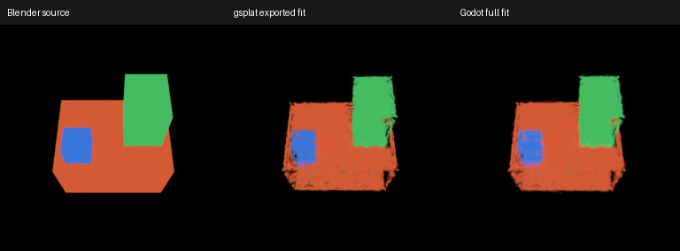

# First real calibration fit

Blender asymmetric source, 32 views at 256 px; T4, Nerfstudio 1.1.5,
Torch 2.11.0+cu128, gsplat 1.4.0. 1,000 steps. Completed training, held-out
evaluation, PLY export and Godot import on 2026-09-07 UTC.

This short run used the default 2 training downscales; later runs use full
capture resolution from the start. It is pipeline validation, not quality
acceptance. Exported 3,574 Gaussians, reduced to 1,200 for the first import.

Camera 0 source/gsplat PSNR: 21.157 dB. Exact-camera full-cloud gsplat/Godot
PSNR: 34.594 dB. This is a single-view renderer comparison; four held-out
views are summarized in eval.json. Preserve full fits before pruning.

The checkpoint and full exports are locally saved in ignored assets/training.
The source is reproducible with tools/pipeline/blender/make_calibration.py.
