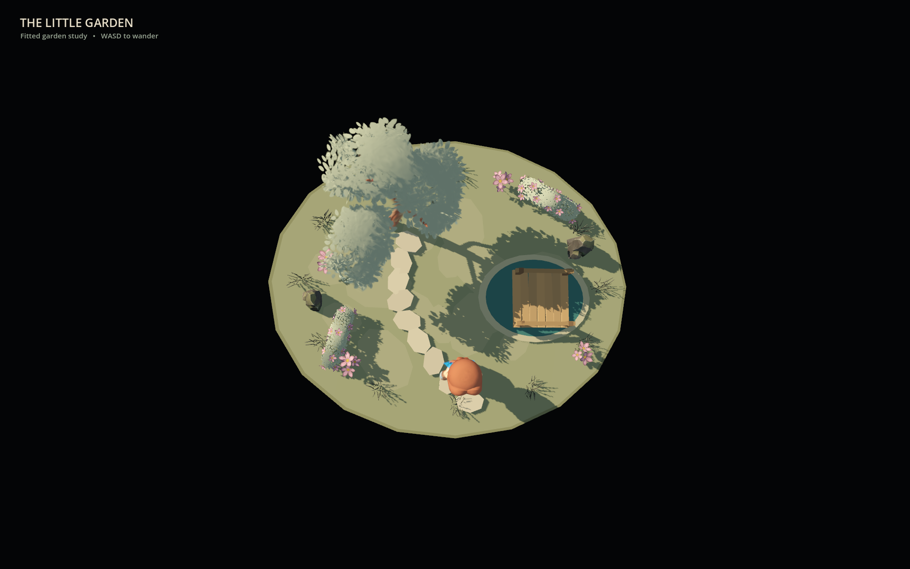

# Fitted garden validation

Real CC0 Quaternius tree and KayKit Ranger: Blender 4.1.1 captures, Colab T4
Nerfstudio 1.1.5 / gsplat 1.4.0 / Torch 2.11+cu128 full fits, contribution-ranked budget
refinement, then joint color/alpha/normal refinement.

| Asset | Full population | Final population | Final held-out PSNR | SSIM |
| --- | ---: | ---: | ---: | ---: |
| Tree | 26,957 | 8,000 | 30.829 | .96095 |
| Ranger | 12,945 | 3,000 | 38.475 | .99001 |

The final metrics use the refinement evaluator consistently. Normal-map MAE
fell from .05141 to .02327 for the tree and .01389 to .00411 for the Ranger.
Reports, source recipes and resource checksums: `assets/clouds/garden/*-fit.json`.
Full checkpoint/archive data is locally preserved in ignored `assets/training`.

The image is a separate visual study, not approval of the final game scene.
Tree/character are actual clouds; remaining props are source/procedural meshes.
Character is static idle with translation/turning, not a trained walk cycle.
Camera, black void and afternoon light direction remain locked.

The learned-normal lighting path improves prior large lighting patches but
foliage remains soft and dense. Character face visibility at the locked camera
is limited. Source-mesh shadow proxies are still required. Original main scene
is unchanged. See benchmark.json for measured local M1 Pro performance.
