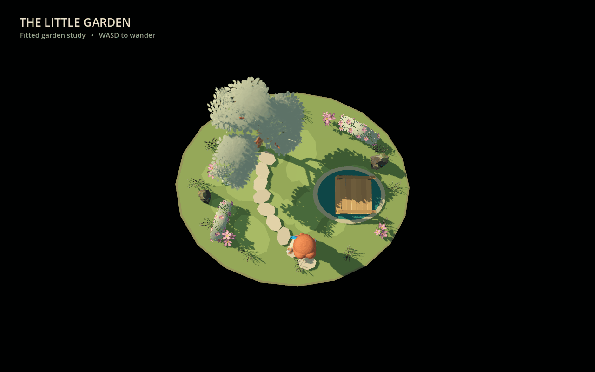

# Ranger walk validation — 2026-09-08

Ten frames at 10 FPS, 3,000 persistent Gaussians per frame. Source-rig deformation
of the trained idle cloud, not independently fitted poses. Centers, covariances
and learned normals deform together; colors and opacity remain identical.
`clip.json` in the cloud directory records hashes and shared normalization.

Godot 4.7.1 / Metal checks pass: finite geometry, positive scales, unit normals,
persistent colors/opacity, movement every frame, loop continuity, WASD movement
and idle reset. Mean per-point adjacent-frame movement ranges 6.1–21.1 mm;
last-to-first is 6.1 mm. Corresponding source/fitted frame 02 is included for
visual inspection; no animated-pose PSNR claim is made.

Final moving/turning animated benchmark: 240 frames, 1280×800, Apple M1 Pro:
65.68 FPS mean, 15.225 ms mean, 16.001 ms p95. Eliminating an immediate pose
commit avoids uploading twice when both pose and world transform change.
These are local measurements, not an M4 or Colab benchmark.

The user accepted continuing this asset family. Lawn/pond colors and mild
scene-wide saturation/contrast were adjusted; raw trained assets are unchanged.
The main game remains separate from this study. Source-mesh shadow proxies,
per-batch sorting, joint-deformation artifacts and the remaining mesh scenery
still need consideration before wider game integration.

